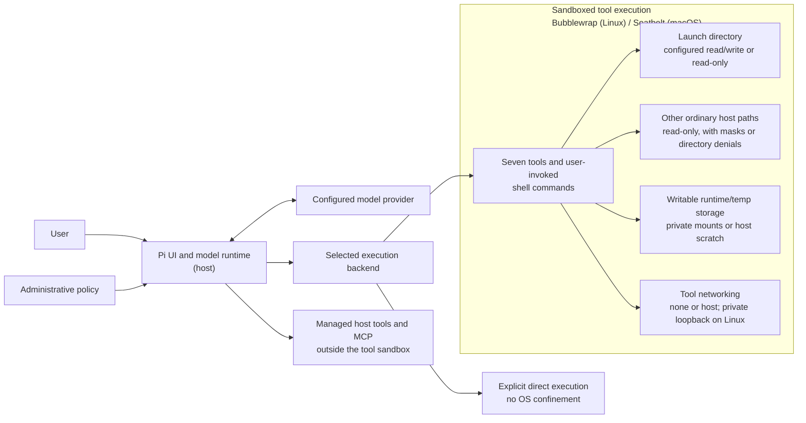

# Pi Sandbox

Pi Sandbox is a managed distribution of [Pi](https://github.com/earendil-works/pi)
for user-invoked, interactive sessions. It enforces administrator-defined policy
for every model-invoked tool and runs built-in operations through an
administrator-selected execution backend.

Pi Sandbox is intended for administrators and engineers using internally hosted
models to work on servers, including production systems. Typical uses include
troubleshooting, log review, and preparing configuration files, with explicit
administrative control over model tools' ability to modify files or access
production services.

## Purpose and scope

Pi Sandbox runs its seven filesystem and shell tools and user-invoked `!`
commands through the administrator-selected backend: Bubblewrap on Linux,
Seatbelt on macOS, or explicit direct execution. Administrators determine which
model tools are available, which require approval, whether the launch directory
is writable, and which tool networking mode is permitted. Approval never
broadens the configured execution boundary.

Both confined backends preserve host absolute paths and make ordinary host files
read-only outside the writable launch directory and runtime scratch locations.
Bubblewrap provides private mounts, temporary storage and namespaces;
`filesystem.hidden_paths` masks selected files and directories. Seatbelt uses
host paths and real host scratch directories; `filesystem.denied_paths` denies
access to selected directories instead of masking them. Seatbelt cleanup is best
effort: background descendants may survive completion, cancellation, shutdown,
or owner death with their original grants. Direct mode preserves tool policy,
approvals and typed operations but provides no filesystem or network containment.

Pi Sandbox is designed for interactive use with an attentive user. Its boundary
governs operations routed through `pi-sandbox` and complements the account and
server controls that govern other software run by the logged-in user.

## Execution backends and reusable extensions

| Backend                             | Supported hosts                                  | Tool filesystem                                                             | Tool networking                   |
| ----------------------------------- | ------------------------------------------------ | --------------------------------------------------------------------------- | --------------------------------- |
| Bubblewrap (Linux packaged default) | Linux x86-64 / arm64                             | Host read-only, optional writable CWD, private runtime/temp storage, masks  | None, private loopback, or host   |
| Seatbelt (macOS packaged default)   | macOS arm64 / x86-64 (qualify each architecture) | Host read-only, optional writable CWD, real host scratch, directory denials | None or host; no private loopback |
| Direct (explicit)                   | Linux and macOS x86-64 / arm64                   | Ordinary host access                                                        | Host                              |

Packaged defaults are explicit policy settings. `execution.backend` is required
in configuration; there is no automatic backend fallback.

Ordinary Pi can load the same [sandbox tools](packages/sandbox-extension/README.md)
or the independent [Git extension](packages/git-extension/README.md). These
standard extensions do not impose the managed application's permission policy.
The sandbox package's public tool factory also accepts an application-supplied
executor. Its interface describes command execution and lifecycle operations,
without naming a backend or providing container management. The embedding
application owns the implementation, isolation boundary and cleanup.

## Isolation at a glance

The configured backend determines where the seven tools and user `!` commands
run. Model traffic, managed host tools and MCP remain outside the tool sandbox.
The backend table above summarizes the platform differences.



## What it enforces

- Bubblewrap and Seatbelt preserve ordinary host absolute paths, with configured
  exclusions and read-only access outside writable workspace/runtime locations.
  The launch directory remains the working directory for all seven tools and
  shell commands. `filesystem.cwd_writable` controls writes there for both
  confined backends; direct mode uses ordinary host permissions.
- Administrator policy determines whether model tools capable of modifying
  files in the launch directory are available and whether they require user
  approval.
- Bubblewrap owns a process-lifetime namespace with private temporary/runtime
  storage. Seatbelt applies policy to independent commands using real host
  scratch directories and best-effort cleanup. Both use cleared tool environments
  with fixed runtime values and explicitly configured sandbox variables.
  Tool networking follows the selected backend's supported policy modes.
- All seven Pi tools (`read`, `grep`, `find`, `ls`, `write`, `edit`, and `bash`)
  and user `!` commands use the selected backend. The model-visible `bash` tool
  can be disabled while typed tools remain available; human `!` remains fixed-allow.
- Administrative policy always starts at the config path compiled from the
  build-selected distribution manifest; its
  required `models_file` selects the complete model catalog. Pi's internal model
  catalog is disabled.
- The main configuration defines the global scoped environment. On Linux, an optional
  root broker can combine named or numeric user/group rules into a patch for environment, model
  catalog, execution backend, network mode, CWD write access, MCP server enablement and approval policies,
  and complete per-tool policy overrides without exposing other users' files.
  Pi, sandbox, and individual managed-extension variables remain isolated; the
  environment never enables a tool or grants approval.
- The Pi Sandbox extension is forced inline. User- and directory-local
  extensions, built-in extension factories, stock tool implementations, and Pi
  package-management commands are disabled.
- A build-selected distribution manifest statically composes managed tools and
  standard Pi tool-only extensions. Both use the same per-tool policy; managed
  extensions additionally use Pi Sandbox's bounded host-command contract. On
  Linux it also selects either an unmanaged system Bubblewrap path or a
  verified Bubblewrap binary bundled beneath Pi Sandbox's libexec directory.
  On macOS an optional pinned tool bundle supplies selected GNU utilities and
  host `fd`/`rg` with their dependent libraries. Selection is fixed at build time;
  ordinary distributions keep system tools.
- Every model tool has an explicit `allow`, `ask`, `deny`, or `disabled`
  policy. Optional session grants are memory-only and independently configurable
  for each tool.
- Configuration, model files, host prerequisites, and the selected executor
  probe are checked before the interactive application starts.
- Interactive execution is available only to unprivileged Unix users. The
  application refuses to start Pi when its effective UID is root; this has no
  configuration override.

The sandbox boundary applies to tool and shell processes. Pi handles model API
connectivity separately on the host, so tool-network isolation does not
interrupt configured model providers. Filesystem reads remain subject to the
Unix account's permissions. See the [security model](docs/security.md) for
detailed guarantees and trust assumptions.

## Distribution and operation

A locally built deployment archive contains a precompiled Bun application built from an exactly pinned,
minimally patched Pi release, the separately maintained Pi Sandbox extension,
and the extension manifests selected by its distribution manifest.
Linux packages also include a small static Rust identity broker that is
inactive unless configured:

```text
pi-sandbox
  -> managed Pi
     -> forced Pi Sandbox extension and approval policy
     -> selected executor: Bubblewrap (Linux), Seatbelt (macOS), or direct
        -> bounded tool operations with backend-specific lifecycle
```

Installed hosts need supported Linux or macOS plus the platform prerequisites
listed in the installation guide. A system or bundled Bubblewrap provider is
required only for Linux Bubblewrap mode.

GitHub releases contain source and release notes, without uploaded binaries.
Build a deployment archive from a source checkout first. Install the documented
[build prerequisites](docs/installation.md#building-a-release), including Node 24
and Rust/Cargo 1.85+ for Linux, then run:

```sh
env -u NODE_ENV npm ci
env -u NODE_ENV npm run verify:release
```

This verifies and builds the default distribution. The archive is written under `release/`. Extract it on the target host, review
its packaged policy, and run these commands **from its extracted directory**:

```sh
sudo ./install.sh
cd /path/to/directory
pi-sandbox
```

Run the installer as root, but launch `pi-sandbox` as the intended unprivileged
user. The executable permits its installer-only validation commands as root but
refuses to start Pi with effective UID `0`.

A normal upgrade preserves the compiled configuration directory. Use
`install.sh --replace-config`
only when intentionally deploying the configuration packaged with a release.
See [installation and operation](docs/installation.md).

Pi Sandbox has its own release version. A tagged `0.10.0` build using Pi `1.3.0`
shows `1.3.0+ps.0.10.0` in `pi-sandbox --version` and the TUI header. Development
builds add source identity. See [versions and releases](docs/releases.md) for
the independent version numbers and source-only GitHub release process.

`PI_CODING_AGENT_DIR` continues to select user-owned sessions, settings, skills,
themes, and logs. It does not redirect policy, the selected model catalog, or
extension loading.

## Configuration

The default distribution's administrative inputs are:

```text
/etc/pi-sandbox/config.toml
/etc/pi-sandbox/models.json
```

A version-3 distribution manifest with `allow_config_override = true` enables
a leading `--config FILE` option for caller-selected policy. Managed builds
set it to `false` and reject the flag. The selected TOML still requires an
absolute `models_file`; no built-in model catalog is enabled.

Broker mode may additionally use root-managed
`/etc/pi-sandbox/users.d/*.toml` and `/etc/pi-sandbox/groups.d/*.toml` drop-ins. Both directories are optional;
without a matching file the main configuration applies unchanged.
See [user and group environment and overrides](docs/identity-broker.md).

Policy configuration is strict and versioned. Every model tool must be present;
missing, unreadable, invalid, and unknown policy fields stop startup. Details
and a complete example are in
[configuration and approvals](docs/configuration.md).
Provider definitions, API-key resolution, and model troubleshooting are in
[models and authentication](docs/models.md).

## Interactive diagnostics

The `/sandbox` command reports the initialized boundary without exposing secrets or
adding content to the model conversation. Use `/sandbox mounts` for the concise
effective mount policy, `/sandbox policy` for all tool policies, the fixed user
shell behavior, and current session grants, or `/sandbox policy <subject>` for one subject. See
[configuration and approvals](docs/configuration.md#interactive-diagnostics).

## Development

Development requires Node.js 24 or newer. Keep `NODE_ENV` unset:

```sh
env -u NODE_ENV npm ci
env -u NODE_ENV npm run verify:release
```

Tests are offline and never contact a live model provider. See
[testing](docs/testing.md).

## Documentation

These subject documents collectively describe the current product behavior.

- [Architecture](docs/architecture.md)
- [Configuration and approvals](docs/configuration.md)
- [Models and authentication](docs/models.md)
- [User and group environment and overrides](docs/identity-broker.md)
- [Installation and operation](docs/installation.md)
- [Versions and releases](docs/releases.md)
- [Standalone sandbox extension](packages/sandbox-extension/README.md)
- [Standalone Git extension](packages/git-extension/README.md)
- [Security model](docs/security.md)
- [Testing](docs/testing.md)
- [Pi integration and upgrade contract](specs/pi-integration.md)

## License

[MIT](LICENSE)

## Acknowledgements

Pi Sandbox builds on several open-source projects:

- [Pi](https://github.com/earendil-works/pi), the coding agent and extension API
  used by the managed application and standalone extensions.
- [Bubblewrap](https://github.com/containers/bubblewrap), the default Linux
  sandboxing backend.

Pi Sandbox incorporates a pinned, minimally modified build of
[Pi](https://github.com/earendil-works/pi), Copyright (c) 2025 Mario Zechner,
distributed under the
[MIT License](https://github.com/earendil-works/pi/blob/v1.3.0/LICENSE). The
exact upstream version, commit, and source archive are recorded in
[`pi-source.lock.json`](pi-source.lock.json); Pi Sandbox's changes to that source
are maintained in [`patches/pi`](patches/pi/).
