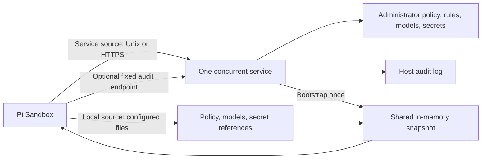

# Managed configuration and audit service

Status: reviewed implementation contract. The user resumed end-to-end implementation
in a new worktree from the workspace baseline, with subagents and iterative Keel
Fable and Sedes code reviews. Deployment, merge and release remain outside scope.

Implementation baseline: create the new worktree from the implemented workspace-mode
change, which must land before the service change. The inspected implementation is `be8b7af00510ad9fb8d22cc980783cefa18bedba`
(PR 58), based on main `c56904083ce6c3ccf3a17a253a379d5837224cff`: Pi 1.5.0,
main schema 15, rule/broker version 11, audit wire 5/record 6. Reconcile with its
actual merged revision before integration; there is no pre-workspace implementation
path or compatibility parser. The subject documents in `docs/` remain the current
product contract until this service work is implemented.

## Intent and settled decisions

Replace the optional, systemd-per-connection identity broker and audit collector
with one concurrent configuration and audit service. A build selects either
service configuration or local-file configuration. Both source loaders produce
one immutable administrative snapshot for the shared validation, workspace,
model/authentication and execution pipeline; the accepted snapshot lasts for the
process lifetime. Local-file support is an explicit end-state profile, not a
service outage fallback or a compatibility layer.

- Both Linux and macOS service clients may use HTTPS. Linux clients may instead
  use a local Unix-domain socket. Transport is independent of execution backend.
- One versioned HTTP/JSON protocol serves both transports and both functions.
  One daemon can enable its Unix and HTTPS listeners simultaneously.
- Linux Unix-socket identity uses `SO_PEERCRED`. HTTPS uses a distribution-provisioned
  shared credential and an explicitly trusted client assertion of username.
- The distribution fixes the configuration source and every configured service
  endpoint/trust set. Service builds reject local source selection. Local-file
  builds retain a fixed default file and explicit build-gated `--config` support.
- The selected source owns policy, catalog and administrative secret inputs;
  user/group rule resolution belongs only to the service profile. The client validates the complete
  effective configuration and enforces ordinary approval/execution boundaries.
- Preserve workspace modes and shared `audit.tools`. The client validates all
  modes, resolves account access, selects one, then applies remaining account
  policy once. The service sends these inputs separately rather than composing modes.
- Service bootstrap is mandatory for service builds. Local-file builds need no
  daemon when auditing is disabled; they may compile a fixed audit endpoint for
  optional auditing through the same protocol and audit manager.
- An audited invocation requires acknowledgment before execution, as today.
  Failure is latched for the current attempt, but each later explicit user-message
  or user-export checkpoint can reconnect. No failed event/effect is replayed.
- Preserve current tool/export audit coverage. Check the connection before accepting
  a new user message; a failed check can reject that message before its LLM request.
  Do not add control over background LLM/auth activity or the application lifecycle.
  User exports may run with writable or read-only CWD on a confined backend. The
  host publisher retains its user-review/audit gates and private scratch exclusion;
  writable-CWD destination/staging races are accepted under host-user authority,
  as documented in [the export contract](user-sandbox-save.md#host-publication-and-replacement).
- Model credentials come from the selected administrative snapshot by default. Personal Pi credentials
  require explicit administrator opt-in for named configured providers.
- Ordinary Pi extension packages remain independently usable without this service.

The service is not an executor, privileged launcher, general file API or proxy for
tool operations. Existing sandbox backends, filesystem guarantees, approval
scopes, command scheduling and cleanup limitations remain unchanged.

Both profiles retain the same strict policy/model authentication, mandatory
extensions and tool execution rules. A configurable local build lets its owner
author those policies; it does not restore arbitrary extensions, ambient provider
credential fallback or command-based key resolution. User-defined loopback model
additions remain a separate deferred task and are not part of this change.

Keep the implementation straightforward: restart the daemon for TLS/credential changes;
reconnect inside the audit client; use ordinary separate client/service
packages. Do not add hot reload, a held-input scheduler, same-host instance
management, automatic replay, policy caches or device enrollment.



## Trust and authentication

### Distribution bootstrap

Distribution schema 4 requires one immutable `configuration` descriptor per
platform. It is a strict union of a service source and a local-file source; the
executable cannot switch between them at runtime. Service examples:

```toml
[platforms.linux.configuration]
source = "service"

[platforms.linux.configuration.endpoint]
transport = "unix"
socket_path = "/run/pi-sandbox/service.sock"

[platforms.darwin.configuration]
source = "service"

[platforms.darwin.configuration.endpoint]
transport = "https"
url = "https://policy.example.net/v1/service"
basic_username = "managed-clients-v1"
basic_password_file = "/absolute/build-input/bootstrap-password"
send_machine_id = false
# Optional; replaces the bundled public roots for an internal service:
# tls_ca_file = "/absolute/build-input/service-ca.pem"
```

The local-file variant is:

```toml
[platforms.linux.configuration]
source = "local"
config_dir = "/etc/pi-sandbox"
allow_config_override = false
# Optional: configuration.audit_endpoint uses the same endpoint shape above.
```

Local requires exactly `source`, `config_dir` and the Boolean
`allow_config_override`, with optional `audit_endpoint`. Its normalized absolute
`config_dir` fixes the default `config.toml` and installed default `models.json`
locations. A true override flag permits the existing leading `--config FILE`;
false rejects it. Service requires exactly `source` and `endpoint`, and rejects
local-file fields, `audit_endpoint` and `--config`. Its one endpoint serves both
configuration and auditing. Local `audit_endpoint`, when present, supplies only
optional auditing; it cannot supply or override local policy. If effective local
policy enables audit without a compiled audit endpoint, static source validation
fails during startup, mode listing and `--validate-installation` (including build
and installer checks). This descriptor guard does not apply to the independent
`--validate-bootstrap` wire-fixture validator.
Disabled local auditing performs no audit-network or transport-identity lookup.

Both endpoint positions use one shared strict transport shape. Linux may use
Unix or HTTPS; macOS may use HTTPS. Unix accepts only transport/socket_path;
HTTPS accepts only the shown HTTPS fields. All fields except `tls_ca_file` are
required for their variant. Reject mixed variants, unknown fields, relative paths,
URL credentials, query/fragment components and an HTTP rather than HTTPS URL. Preserve existing
build-selected executable/tool-bundle capabilities independently.
The URL is the complete public HTTPS endpoint. The client posts every operation
to its parsed pathname without appending a suffix. Direct daemon connections use
`/v1/service`; reverse proxies may expose custom public paths and rewrite them to
the daemon's fixed `/v1/service` route. The compiled URL remains immutable, and
query strings, fragments and URL credentials remain rejected. These rules apply
to both service `endpoint` and local `audit_endpoint`.
Use standard URL parsing/serialization at build time: an omitted path becomes `/`,
dot segments are resolved, spaces are percent-encoded, and repeated slashes are
preserved. Compile and record the resulting URL in release metadata; service-source
provenance/diagnostics include its full path, distinguishing endpoints on one origin.
`send_machine_id = true` is valid only
for macOS; Linux HTTPS descriptors require false until a Linux identity source is
separately specified.

Distribution schema 4 has this complete key inventory; service packaging has no
role/instance selection in the client distribution:

| Location           | Keys                                                                                                         |
| ------------------ | ------------------------------------------------------------------------------------------------------------ |
| Root               | Required `version = 4`, `extension_manifests`, `platforms`; optional `skills_source`                         |
| `platforms`        | `linux` and/or `darwin`; selected build platform must be present                                             |
| `platforms.linux`  | Required `libexec_dir`, `launcher_path`, `configuration`, `bubblewrap`; optional `tool_bundle`               |
| `platforms.darwin` | Required `libexec_dir`, `launcher_path`, `configuration`; optional `tool_bundle`                             |
| `configuration`    | Exactly one source variant defined above                                                                     |
| Endpoint fields    | Exactly the transport-specific fields above, in service `endpoint` or local `audit_endpoint`                 |
| `bubblewrap`       | Existing strict `{ mode = "system", path }` or `{ mode = "bundled", binary, version, sha256, license_file }` |
| `tool_bundle`      | Existing strict `{ directory, inventory_sha256, commands }`                                                  |

Preserve existing extension-manifest, skill-source, inventory, command-selection,
path and installation-layout validation. Remove old root `allow_config_override`
and platform `config_dir`, `identity_socket_path`, `audit_socket_path` and
`service_dir` fields; there are no aliases to the new union. Unknown and removed
fields are errors. The source tag and its complete descriptor are compiled into
the application and recorded in release metadata without credential contents.

The password and any custom CA bundle are build inputs compiled into the executable;
their source paths do not become runtime references. Password reads are bounded regular UTF-8
files, 32 to 8192 bytes after one LF/CRLF removal, with no NUL/control characters.
Deployment generates passwords from at least 256 bits of cryptographic randomness;
length validation cannot prove entropy. Basic usernames are nonempty printable
ASCII without colon, at most 128 bytes.
Custom CA input is a bounded valid PEM CA bundle, at most 1 MiB. Validate supplied
inputs during the build. Never copy the password file into a release payload or print its content,
source path or standalone digest in logs, public provenance or diagnostics.
The final executable necessarily contains the credential and is checksummed normally.

Both client and daemon require TLS 1.2 or newer, preferring TLS 1.3.
By default, TLS uses the pinned runtime's bundled public CA roots and normal
certificate-name verification. It does not use the mutable host trust store.
An optional `tls_ca_file` replaces those public roots with the supplied compiled
bundle; it does not silently union in local/system roots. Select the trust set
explicitly in the shared service HTTP client (for example, the runtime's bundled
`tls.rootCertificates` for the public default), and qualify this behavior in the
actual Bun executable on every supported platform. Runtime
CA-file, proxy, endpoint and insecure-TLS environment settings cannot replace the
endpoint trust or routing. Reject redirects; do not send authentication to a
different origin. Service hostname resolution is normal DNS under this TLS trust.

Release builds require Bun 1.4.4 or newer. Compiled qualification found that older
Bun versions augmented an explicit CA list with the default trust store, including
host/environment roots. Use the upstream corrected TLS implementation; do not
weaken the replacement-trust contract or add an application certificate verifier.
The compiled matrix must exercise both the public-root default and custom bundle
under hostile startup CA settings, as well as direct routing under proxy settings.
Endpoint/trust-set/service-password changes require a new distribution; use a stable
service hostname operationally. Credential revocation may reject old distributions.
Ordinary server-certificate renewal under the selected trust set needs no client
rebuild. Public-root updates arrive through rebuilt runtime/distribution releases.

The service-access credential is independent of application configuration. It
cannot depend on a returned service value or a local policy/environment value.
Provider and MCP ingress credentials are separate inputs even
when an administrator chooses equivalent values.

Remove `identity.mode` and the old broker/collector endpoint contract in both
profiles. Account/group rule resolution belongs to service configuration only;
the local profile has no broker, rule-directory discovery or remote override
lookup. Keep service installation paths as packaging data, not alternate client
policy sources. User state, project files, CLI, loaded policy and environment
cannot change the compiled source tag, endpoint or override capability. A failed
service request never selects the local loader.

### Identity by transport

For every accepted Unix connection, read kernel peer credentials before dispatch.
Use the UID for account and primary/supplementary membership resolution through
the existing bounded, trusted host NSS mechanism. Retain the peer PID for Unix
audit attribution. Ignore environment-based identities. Unix requests must omit
the HTTPS identity assertion; it cannot replace kernel credentials. Protect the
socket and ancestors with the existing root ownership/non-writable-ancestor checks.

HTTPS requires Basic authentication on every request, checked by the service over
TLS. The Basic account identifies the provisioned client population, not the
asserted application user. The body contains a canonical OS-derived `username`,
and, only when the build requests it, a `machine_id`. Use existing bounded client
OS account/hardware lookups, not `$USER`, `$HOME`, environment IDs or caller CLI
identity flags. Username is mandatory; machine ID is optional metadata and never
a required authentication factor or policy selector in this revision.
When `send_machine_id` is true, failed/invalid hardware lookup fails the relevant
service operation: bootstrap/inspection for service configuration, or the audit
operation for an audited local-file profile;
do not silently omit a build-required assertion. False performs no hardware lookup
for transport identity (policy macros may independently require one).

The service trusts authenticated HTTPS clients to assert usernames. All holders
of a shared credential can claim another admitted username, retrieve its matching
policy/secret values, and submit events under that assertion. There is no enrollment,
approval-of-seen-user flow, device attestation, or cross-user secrecy guarantee
between credential holders. A copied hardware UUID does not improve that guarantee.
Bundled credentials must be treated as extractable, including without root access.
The official binary enforces its source contract; the design does not prevent a
machine owner from running modified software.

Record identity provenance explicitly. Unix records carry kernel UID/PID and
resolved account name. HTTPS records carry the configured Basic credential name,
asserted username and optional asserted machine ID. Never fill remote principal
UID/PID fields using the service host or label an HTTP assertion kernel-verified.
The raw Basic password is never an audit field.

### HTTP account rules

HTTPS uses exact, case-sensitive username-selected user rules. It does not run
server NSS against an asserted username/UID and infer equivalence with a server
OS account. HTTPS listener rule directories must contain only username selectors
in `users.d`; reject numeric-user selectors and nonempty `groups.d` during service
validation and bootstrap. Do not silently ignore restrictive rules written for
Unix identities. Unix listeners retain name/numeric user/group matching. Listeners
may share a rule directory only if it satisfies every consuming listener's rules.
Client groups/UIDs are not accepted in HTTPS requests. Directory-backed remote
groups and machine-specific policy are separate future features.

When no rule matches, inherit the listener's base policy, as today. Main-only
administrative controls and existing least-restrictive joins/conflict errors remain.

## Service ownership and authored inputs

Provide one Linux static Rust executable, `pi-sandbox-service`, and one ordinary
root systemd service. The executable may also run directly as an unprivileged
account when every listener is HTTPS. Any Unix listener, including a mixed
Unix/HTTPS manifest, requires root. It binds its configured listeners and handles connections
concurrently; it never spawns a systemd unit or application process per client.
No new privileged service is installed on macOS: Mac clients use HTTPS.

Derive administrative ownership from the effective service UID; it is not a
manifest option or client trust setting. Offline `--validate` and normal startup
use the same account/listener admission and ownership rules. Reject non-root Unix
or mixed manifests before reading listener material or binding any listener; do
not partially activate the HTTPS subset. Keep Unix socket and ancestor checks
root-only on both sides. No protocol/schema change or runtime client endpoint
override accompanies unprivileged HTTPS hosting.

Use a strict service manifest, version 1. The administrator-owned unit supplies
its absolute path through `pi-sandbox-service --manifest FILE`; the default unit
uses `/etc/pi-sandbox-service/main/service.toml`. There is no environment/path
discovery. Root keys are exactly `manifest_version`, optional `limits`, and
`listeners` (one to sixteen entries). Example (limits omitted use the defaults
specified below):

```toml
manifest_version = 1

[[listeners]]
id = "local_linux"
transport = "unix"
platform = "linux"
socket_path = "/run/pi-sandbox/service.sock"
audit_facility = "local0"
policy_file = "/etc/pi-sandbox-service/main/linux.toml"
rule_directory = "/etc/pi-sandbox-service/main/local-rules"

[[listeners]]
id = "remote_macos"
transport = "https"
platform = "darwin"
listen_address = "0.0.0.0:9443"
certificate_file = "/etc/pi-sandbox-service/main/tls/certificate.pem"
private_key_file = "/etc/pi-sandbox-service/main/tls/key.pem"
audit_facility = "local0"
policy_file = "/etc/pi-sandbox-service/main/macos.toml"
rule_directory = "/etc/pi-sandbox-service/main/remote-rules"

[[listeners.credentials]]
name = "managed-clients-v1"
password_file = "/etc/pi-sandbox-service/main/credentials/v1"
```

Every listener requires a distinct `id` matching `[a-z][a-z0-9_]{0,31}`,
`transport`, `platform` (`linux` or `darwin`), `policy_file` and `audit_facility`.
`audit_facility` is exactly one of `local0` through `local7` and determines syslog
routing for every audit session on that listener. Neither policy files nor client
requests can select a facility. `rule_directory` is optional: absence means no
rules; presence names an existing protected
directory containing optional `users.d` and `groups.d` directories with the
existing bounded `*.toml` inventory. A misspelled/missing declared root is an
error. Listeners may share policy/catalog/rule sources subject to the same checks.
All file/socket/directory paths are normalized absolute paths, at most 4096 UTF-8
bytes without NUL, with no macro expansion.

Unix is Linux-only, additionally requires `socket_path` and forbids HTTPS keys.
HTTPS additionally requires `listen_address`, `certificate_file`, `private_key_file`
and `credentials`; it forbids `socket_path`. Addresses are numeric IPv4:port or
bracketed IPv6:port, port 1–65535; no DNS, URL, wildcard shorthand or port zero.
Define explicit IPv6-only binds to avoid implicit dual-stack collisions.
`credentials` contains one to four exact `{ name, password_file }` tables with
distinct Basic usernames and password bounds matching the client descriptor.
The `limits` table accepts only the named tunable fields in the bounds table below.
Reject all unknown keys and omitted required fields before binding any listener.

Certificate/private-key files and passwords stay service-side. TLS is implemented
in the daemon; a plain TCP HTTP listener is not provided. An upstream proxy may
forward to HTTPS but cannot turn remote assertions into Unix peer identity.

Each listener selects its administrative sources; requests cannot supply a file
path, arbitrary policy-profile name or override document. This permits a Unix-listener
Linux policy plus separate Linux HTTPS and macOS HTTPS listeners with different
base policies in one process. Multiple HTTPS listeners use distinct bind endpoints;
reject overlapping binds and duplicated socket paths. The client distribution
selects the intended endpoint; a request cannot redirect to another listener's
sources. Reject a bootstrap platform mismatch. A requested platform/build is compatibility
metadata, not proof of the client's executable or machine.

The same authenticated audit operations accept clients configured from the service
or from local files. Their reported policy origin does not select administrative
sources or change transport identity or authorization. There is no separate local
origin admission switch. Local-file clients use only the audit operations; they
do not request bootstrap, policy inspection or account overrides.

Authentication is listener-wide, not scoped to operations: a caller with Unix
socket access or an HTTPS credential can directly request bootstrap even when its
official local-file build uses that endpoint only for auditing. Provision a
listener intended only for local-profile audit clients with a dedicated complete
policy and catalog containing no inline secrets or secret-file references; do not
point it at the clients' own local policy. Otherwise the service could expose
files those users cannot read directly. Service-package examples must include this
non-secret audit-deployment configuration and security documentation must explain
the boundary. This is deployment guidance, not automatic secret detection or a
second operation-scoping mechanism. The dedicated policy/catalog still satisfy
ordinary service validation. Listener `platform` constrains bootstrap/inspection;
audit operations carry no platform claim and accept the specified event boundaries
from either client OS.

Main policy advances to schema 16 and rules to version 12 based on the stated
baseline. Keep existing policy shapes except:

- Remove the `identity` table in both profiles: configuration source is build-selected,
  and only the service profile resolves user/group rule patches.
- `models_file` remains an absolute reference read by the selected source loader.
  In service profiles it is server-side, selectable by existing user/group model
  override rules, and never reaches the client as a filename to open. In local
  profiles it names the invoking user's directly read administrative catalog.
- Rule version 12 adds `seatbelt` to the backend enum and applies transport-specific
  selector rules above. Linux effective policy admits `bubblewrap`/`direct`;
  macOS admits `seatbelt`/`direct`. Structurally validate all rule values, and reject
  a matching incompatible backend instead of substituting another backend.
  Remove the current blanket macOS broker/audit rejection; macOS still cannot
  select a Unix bootstrap or install the Linux service. All other backend/path/
  network restrictions remain in force.
- Add required main-only `[model_auth] personal_providers = []`. It is an exact,
  distinct list of configured provider IDs, empty by default. Rules cannot change it.
- Retain required `workspace.default`, `workspace.allowed` and `workspace.modes`,
  partial common values, whole invocation-policy replacement, descriptions and
  all-mode validation. Rules retain workspace allowed/default overrides, including
  union of contributed lists, conflicting-default rejection and empty-versus-absent
  semantics. Apply identical joins to HTTPS username rules.
- Retain the exhaustive shared `audit.tools` map; reject obsolete inline tool audit
  fields. MCP per-rule auditing remains separate. Mode-authored Bash command sets
  retain normalized-definition equality for reused IDs across all common/mode
  entries and cannot be redefined by account rules.
- Remove authored `audit.facility` in both configuration profiles and reject it in
  schema 16. The listener's required `audit_facility` owns service-side routing;
  shared policy retains `audit.enabled` and the exhaustive `audit.tools` map.

Assign final version numbers against then-current main at implementation; never
accept both old and new shapes. The numbers here are a coordinated breaking
revision against this baseline, not a reservation against unrelated work.

Administrative manifest/policy/catalog files must be owned by the effective
service UID, non-symlink and not group/world writable; policy/catalog may be 0644.
Ancestors must be non-symlink directories owned by root or that service UID and
not group/world writable. Preserve rule-directory protection and require rule
directories and non-symlink 0600 rule files to belong to the service UID. When
the daemon runs as root, all these inputs and ancestors remain root-owned.
Rule directories remain optional. Their contents remain deployment-owned, not
packaged user records. Reject invalid unmatched rule files structurally.
TLS private keys and Basic-password files require service-UID ownership, non-symlink
0600 files and protected ancestors; public certificate chains belong to the same
UID and may be 0644. An unprivileged HTTPS service may therefore keep inputs under
its protected home directory. Client trust still comes from the compiled endpoint
and TLS hostname/chain checks; client users must not hold server keys or authority
to issue trusted certificates for that hostname. Trial credentials and keys remain
separate from production.
Certificate/key inputs are bounded to 1 MiB each and validated as a matching
usable TLS pair before listener activation. Public chain files include intermediates.

Load and validate manifest, TLS material and Basic credentials at daemon startup.
Changes to these inputs require an ordinary service restart; there is no hot-reload
framework in this revision. Restart creates a new epoch and can interrupt active
work at its next required audit operation; later explicit user actions recover.
Policy/rule inputs reload per bootstrap or inspection; catalog and secret reads
occur only where that operation requires them, as specified below.
Compare fixed-length cryptographic hashes of supplied/expected passwords using a
constant-time primitive; never log either password or its hash. Authentication
has bounded connections/requests, but no additional failed-login lockout or
per-password rate limiter. Offline validation checks protected metadata and file
size; build/startup validate password contents and length.

Retain ordinary-permission/symlink semantics for authored `environment.pi` secret
file references. They resolve on the service host under service credentials,
only after base/rule environment merging. Open only winning references; an
overridden/unmatched reference is not read. Preserve existing bounded regular-file
UTF-8, one-trailing-newline and opaque-literal semantics, and sanitized errors.
Moving main-policy reference reads from the application user to the service is
an intentional authority change; deployment must control those references.

Client operational paths still refer to the client: CWD/exclusions, command-path
directories, skill roots, MCP executable paths and user-state locations. They
must not be opened or canonicalized against the service filesystem. Account/home
and machine macros expand on the client against one startup identity snapshot.
Selected external files/assets are not implicitly downloaded by this protocol.

### Resolution and validation boundary

The Rust service validates the manifest and every field it interprets. It loads
bounded TOML, structurally checks policy version/top-level inventory and server
references, and validates/selects/joins rules. It selects the model source and
merges scoped environment to resolve only effective secret references. Workspace
modes cannot change either source, so these operations do not need a selected mode.
It returns the authored common/mode policy, the joined account-policy patch, the
complete resolved environment and catalog as separate bootstrap fields. It does
not compose modes or flatten the account patch into common values.

The service interprets `config_version`, `models_file`, scoped `environment`,
`audit`, `model_auth`, workspace selection metadata, and the rule-controlled portions of `execution`,
`network`, `filesystem`, `tools` and `mcp`. Structural parsing permits partial
common values: `filesystem.cwd_writable` and the whole top-level `exports` table
may be absent when modes supply them. The client checks completeness after
composition. Validate every rule file structurally; only matching rules undergo
inventory membership checks against this listener's active `audit.tools`,
`mcp.servers` and `workspace.modes`. Unmatched rules may name subjects belonging
to another listener policy. Use exhaustive `policy.audit.tools` keys as the
service's named-tool inventory: partial common `policy.tools` may omit tools
supplied by every mode.
The client still checks exact audit-map coverage against its compiled/admitted tools.
Other recognized main fields, including extension settings and main
common/mode command-set definitions, are carried unchanged apart from the representation
rules below. Their complete semantic validation belongs to the compiled client.
Reject unknown top-level policy fields and unknown fields in interpreted shapes;
do not invent a Rust approximation of an extension's private settings schema.

TOML-to-JSON conversion preserves decoded string contents and key spelling,
including case, without camel-case conversion, Unicode normalization or string
interpolation. TOML dotted keys/tables become the equivalent nested JSON objects;
arrays retain order. Object-key ordering, comments and source formatting carry
no policy meaning. Admit only tables, arrays, strings, booleans, integers in
JavaScript's safe range and finite binary64 numbers. Reject TOML date/time values,
non-finite floats and integer-valued numbers outside the safe range anywhere,
including otherwise uninterpreted extension settings. Never stringify unsupported
types or silently round an integer into a different value.

The catalog is strict bounded UTF-8 JSON, decoded and reserialized as an object;
its source bytes and key order are not preserved. Reject comments, a BOM, duplicate keys,
non-finite/unsafe numeric values and unsupported JSON values before delivery.
The client performs the full pinned Pi schema check. The wire adapter admits
only the explicitly specified differences from authored policy and the distinct
resolved-environment/account-patch fields; unknown nested fields are rejected by
the same client semantic/extension validators that reject them in authored input.

Preserve complete named-tool policy semantics, selected-mode command-set
definitions, independent MCP enablement and ordered per-file MCP policy layers.
Do not flatten MCP layers or recursively merge partial invocation policies.
For `tools.bash`, a matching override replaces `mode`, `session_grant` and
`known_read_only` together: omission clears the base `known_read_only`, while
the shared audit Boolean and selected mode's `command_sets` remain unchanged, as
in the current merger. Apply this account patch after mode composition/selection,
never before it or once per mode. No matching rule inherits main access metadata
and the selected composed policy. Conflicts fail the request.

The client remains the authoritative validator for complete product semantics:
strict configuration shape, compiled extension settings, Pi model schema,
available tools/backends, local account expansion and filesystem prerequisites.
Rust cannot execute arbitrary compiled TypeScript extension `parseConfig` methods.
Do not add a TypeScript helper process or dynamic extension loading to the root
service to do so. Invalid effective input never starts Pi or provider work.
Use shared cross-language fixtures for the structural overlay/join contract.
Fixtures must also prove that equivalent authored and service-wire inputs yield
the same internal policy after the same overlays and symbolic expansion inputs,
including untouched extension settings, key spelling, numeric boundaries,
opaque literals and ordered MCP layers. Deliberately invalid examples must be
rejected at their owning validation boundary, never accepted through conversion.

Read fresh administrative inputs for every bootstrap or policy-inspection request. Hold bounded
snapshots of their bytes for that request, then retain only the audit metadata
needed for active sessions. No cross-request resolved-secret cache. Source files
are not a multi-file atomic transaction; administrators coordinate replacements.
The response is one immutable snapshot of exactly the inputs read for that request.
An invalid replacement never falls back to last-known-good policy.

## One HTTP protocol

Both listeners implement `POST /v1/service` with JSON, UTF-8 and version 1.
Use one strict tagged request union, one response union and shared operation
handlers, not a second newline-framed Unix protocol. Unsupported paths/methods,
unknown fields/versions, duplicate JSON keys and malformed text are errors.

Every request is an object containing exactly `version: 1`, `request_id`,
`operation` and the operation-specific fields below. HTTPS additionally requires
`identity: { username, machine_id? }`; Unix forbids `identity`. The optional field
is present only when the compiled descriptor requests it. `request_id` provides
correlation, not idempotency. All object shapes reject unknown and duplicate keys.

| Operation        | Additional request fields                                                                                            | Exact successful `result` fields                                                         |
| ---------------- | -------------------------------------------------------------------------------------------------------------------- | ---------------------------------------------------------------------------------------- |
| `bootstrap`      | `policy_schema: 16`, `model_schema: "pi-1.5.0"`, `client: { platform, architecture, application_version, build_id }` | `policy`, `overrides`, `environment`, `models`, `policy_revision`                        |
| `policy_inspect` | Same compatibility and client fields as `bootstrap`                                                                  | `policy`, `workspace_overrides`                                                          |
| `audit_open`     | `client_instance_id`, `audit_generation`, `pi_session_id`, `cwd`, `policy_origin`                                    | `audit_session_id`, `service_epoch`, `audit_generation`, `next_sequence`                 |
| `audit_check`    | `audit_session_id`, `service_epoch`                                                                                  | `audit_session_id`, `service_epoch`, `audit_generation`                                  |
| `audit_event`    | `audit_session_id`, `service_epoch`, `sequence`, `event`                                                             | `audit_session_id`, `service_epoch`, `audit_generation`, `next_sequence`                 |
| `audit_close`    | `audit_session_id`, `service_epoch`, `sequence`                                                                      | `audit_session_id`, `service_epoch`, `audit_generation`, `next_sequence`, `closed: true` |

`event` is the existing strict audit wire-5 tool/export event union, excluding
`session_started` and `session_ended`. Retain its field names and individual
bounds; admit `seatbelt` as a boundary. Its `pi_session_id` must equal the session
bound by `audit_open`. Close derives its Pi session ID from the bound session
and cannot select another one.

Successful envelopes have exactly `version`, `request_id`, `operation`, `result`.
Error envelopes have exactly `version`, optional safely parsed `request_id`, and
`error: { code, message }`. Request IDs, client-instance IDs, service-session IDs,
service epochs and policy revisions are 128-bit random lowercase hexadecimal
strings. Pi session IDs are nonempty, at most 256 UTF-8 bytes without controls;
usernames are nonempty, at most 256 UTF-8 bytes without controls. Machine IDs use
the existing canonical hardware UUID format. `platform` is `linux` or `darwin`,
`architecture` is `x64` or `arm64`; application version and build ID are nonempty
printable strings of at most 256 UTF-8 bytes each. CWD is an absolute client path,
at most 4096 UTF-8 bytes without NUL; the client canonicalizes it, never the service.
Error messages are at most 1024 UTF-8 bytes without controls.

`policy_origin` is exactly one of these tagged objects:

- `{ "source": "service", "revision": "<128-bit lowercase hexadecimal ID>" }`:
  the client reports the `policy_revision` returned with its bootstrap snapshot.
- `{ "source": "local" }`: the client reports a locally loaded configuration
  snapshot. This variant has no revision, filename, digest or policy contents.

Reject unknown fields, missing fields and mixed variants. Retain the reported
object unchanged for the audit handle and all its records. Both variants are
client-reported correlation metadata: neither attests the client's executable,
selected workspace mode or enforcement. Do not maintain an issuance registry,
invent a local revision or require a preceding bootstrap to admit an audit-open.
Transport authentication and current listener audit admission still apply.

Bootstrap and policy-inspection schema tags must exactly match the listener's supported policy/model
schemas. Its configured platform must match `client.platform`; application version
and build ID are diagnostic metadata, not an alternate compatibility negotiation.

Generation is a positive JSON safe integer; sequence is a nonnegative JSON safe
integer. Neither wraps. Open records sequence zero and returns `next_sequence: 1`.
Event/close must supply the last acknowledged `next_sequence`. Check has no sequence
and neither consumes nor returns one. Commit the
sequence when syslog submission succeeds, before writing the response; a lost
response cannot roll it back. Refuse an operation whose next sequence would exceed
`Number.MAX_SAFE_INTEGER`, invalidate that session and require a new open. Exhausted
client generations require a new application process, not a reset in place.
Success responses must match the outstanding version/request ID/operation and,
for audit operations, the session, epoch and generation before the client accepts
them. Open/event/close also require the expected sequence transition. Errors validate their own strict shape,
version and request ID when present; their absent success fields are not required.
An error never advances the client's sequence or admits work.

For example, a Unix open request from a service-configured client is:

```json
{
  "version": 1,
  "request_id": "11111111111111111111111111111111",
  "operation": "audit_open",
  "client_instance_id": "22222222222222222222222222222222",
  "audit_generation": 1,
  "pi_session_id": "pi-session-example",
  "cwd": "/home/example/project",
  "policy_origin": {
    "source": "service",
    "revision": "33333333333333333333333333333333"
  }
}
```

Its success result is exactly the following shape, inside the common envelope:

```json
{
  "audit_session_id": "44444444444444444444444444444444",
  "service_epoch": "55555555555555555555555555555555",
  "audit_generation": 1,
  "next_sequence": 1
}
```

The successful bootstrap result has exactly these fields:

- `policy`: the authored common/mode policy as JSON, derived from schema 16.
  Keep `config_version`, `workspace`, shared `audit.tools` and all other authored
  values; omit and reject `models_file` and `identity`. Do not apply account
  patches to this document. Its `environment.pi` contains authored strings or
  strict `{ "file": "/service/path" }` references for symbolic validation only;
  it rejects literal wrappers. These paths are source metadata, never client
  file-read instructions. No runtime path can call `resolveEnvironmentFiles` on
  this source snapshot. Keeping the original entries permits validation even when
  account values replace them. Other source fields retain authored shapes.
- `overrides`: the joined account patch, with required `tools` (possibly empty)
  and optional `workspace`, `execution`, `network`, `filesystem` and `mcp`.
  Preserve broker-11 complete invocation policies, workspace access joins and
  ordered MCP `policy_layers`, with rule-12 backend support. Omit and reject
  `models_file` and environment fields: the service already consumed those to
  produce the other result fields. Reject unknown keys, empty optional patches
  and any account-defined command sets or audit choices. No match returns
  `{ "tools": {} }`. MCP connection definitions remain solely in `policy`.
- `environment`: the complete effective scoped environment after base/rule
  merging and service-side file reads. Require `pi`, `sandbox` and `extensions`
  using the existing bounded scope/value shapes. Pi values are macro strings or
  strict `{ "literal": string }` values; file references are forbidden here.
  Replace the selected policy's environment with this map before expansion;
  never overlay it again or fall back to unresolved source values.
- `models`: the service-selected catalog JSON object, never a URL or filename.
- `policy_revision`: an opaque identifier for this entire delivered snapshot.

These are distinct, strict field contracts, not alternate legacy shapes. Refactor
TOML decoding away from the existing pure authored-entry/all-mode validator and
reuse that validator through explicit authored and wire-source adapters. Adapt
the internal authored-mode and effective-policy types to omit client model-source
and identity-source filenames; do not synthesize placeholders. Only the validated
selected policy with the resolved environment may enter runtime construction.
No endpoint/source override is admitted. Preserve opaque literals during expansion.

`policy_inspect` uses the same authenticated listener, source loader, rule validation
and rule joins. It returns exactly `policy` in the same source shape and
`workspace_overrides`: null when no workspace patch contributes, otherwise the
strict nonempty `{ allowed?, default? }` patch. An explicit empty allowed list
remains distinct from absence and causes the existing no-selectable-mode error.
Do not open catalogs or secret-reference files, resolve account/home macros or
apply environment during inspection. Catalog-dependent `model_auth` membership
checks wait for bootstrap or offline service validation; policy-only shape checks
still apply. The response can contain authored inline secrets and symbolic source
paths, so it has the same authentication, TLS, bounds and log redaction as bootstrap.
It is inspection data, not a usable runtime bootstrap or a cached startup source.

An opaque random policy revision identifies this delivered snapshot. It is not a
public digest of secret values. A service-configured client supplies that revision
inside `policy_origin` when opening audit sessions; a local-file client instead
supplies the revision-free local variant. This remains client-reported correlation
metadata, not remote attestation. The service does not claim to reconstruct an old
snapshot after restart. Do not log
the bootstrap body or policy/model/environment contents.

Authentication/profile/identity are established before operation dispatch.
Audit handles are bound to listener profile and principal (Unix UID/PID or HTTPS
credential name plus asserted username/machine metadata). Every request is
re-authenticated and the binding checked. A handle alone grants no authority.
Remote requests never inherit identity from a reused TCP connection or proxy header.

Use the following exact error codes and status mapping. Configuration errors
never disclose server paths or secrets; server diagnostics also exclude secrets.
Framing failures may close the connection without JSON when a bounded response
cannot safely be constructed. Every non-success status, malformed/truncated
response or unexpected envelope is a failure; no HTTP library retries a POST.

| Code                        | HTTP status | Meaning                                                              |
| --------------------------- | ----------- | -------------------------------------------------------------------- |
| `authentication_required`   | 401         | Missing or invalid transport credential                              |
| `admission_denied`          | 403         | Authenticated request cannot use this listener/handle                |
| `invalid_request`           | 400         | Invalid fields, identity assertion, framing or event                 |
| `unsupported_version`       | 400         | Unsupported service protocol version                                 |
| `incompatible_client`       | 403         | Client metadata fails the listener compatibility contract            |
| `configuration_unavailable` | 503         | Invalid/unreadable effective administrative input                    |
| `audit_disabled`            | 403         | Current listener policy does not admit a new audit session           |
| `unknown_audit_session`     | 410         | Unknown, expired, evicted, revoked or prior-epoch handle             |
| `audit_out_of_order`        | 409         | Wrong sequence or concurrent same-session operation                  |
| `request_too_large`         | 413         | A protocol byte/structure bound is exceeded                          |
| `audit_unavailable`         | 503         | Required syslog submission failed or exceeded its deadline           |
| `busy`                      | 503         | Connection, worker, session or bounded queue capacity is unavailable |

`audit_check` reauthenticates and atomically verifies that the named handle is live
and bound to this principal/listener. It is read-only: no syslog record, sequence
change, idle renewal or per-session operation claim. It can run alongside an append;
its success is only a point-in-time handle check, not a guarantee that syslog or a
later operation succeeds. Perform this bounded in-memory lookup in the nonblocking
HTTP handler; it needs neither blocking worker pool. A missing,
expired, evicted, revoked or prior-epoch handle returns `unknown_audit_session`.

Client disposition is explicit:

| Context                                                                    | Disposition for any transport failure or code above                                                                                                |
| -------------------------------------------------------------------------- | -------------------------------------------------------------------------------------------------------------------------------------------------- |
| Bootstrap                                                                  | Fail startup without local fallback                                                                                                                |
| Policy inspection                                                          | Fail the listing operation without local fallback or audit-session recovery                                                                        |
| Explicit message/export checkpoint                                         | Invalidate the failed binding and reject that submission/action; the next explicit checkpoint can try again                                        |
| Check returns a definite `unknown_audit_session` at an explicit checkpoint | Discard that handle and attempt one open in the same checkpoint; failure rejects the submission/action                                             |
| Required invocation event or first-use open                                | Fail that invocation, invalidate its handle/pending open and reject its queued old-generation events; only a later explicit checkpoint can recover |
| Bounded client audit queue overflow/queue-wait expiry                      | Same invocation/generation failure, even though that event was never sent                                                                          |
| Best-effort lifecycle open/close                                           | Report an unconfirmed lifecycle record; do not block the interface, session change or shutdown, and do not retry that operation                    |

A checkpoint makes at most one check and one open; an absent/invalid local handle
opens directly. Transport failure, malformed response, `busy` and all errors other
than the definite unknown-handle check above reject that attempt, with no retry loop.
Never replay an event or invocation, including after a known pre-dispatch rejection.
Authentication/configuration/protocol problems may continue failing until corrected;
reconnectability is not a promise they heal automatically. Genuine executor/controller/
persistence faults retain their existing fatal classification. Redirects and automatic
POST retries remain disabled.

## In-memory application bootstrap

The compiled source descriptor chooses one loader. Parse managed arguments and
reject root operational invocation and prohibited source overrides before loading.
The service loader resolves requested transport identity, fetches once and validates
the whole response. It does not inspect local administrative files. Authentication,
connection, parse or validation failure fails startup without local fallback.

The local loader reads the selected schema-16 TOML using the existing bounded,
regular-file, strict UTF-8 loader. Validate all authored modes before reading the
selected catalog or resolving secret references. Read its absolute `models_file`
once under the same 2 MiB regular-file/fatal-UTF-8 and strict JSON rules as the
service: reject comments, duplicate keys, a BOM, unsafe numbers and excess nesting.
This deliberately removes Pi's former comment/BOM tolerance for local catalogs.
Then resolve main `environment.pi` references as the invoking account.
Retain ordinary filesystem permissions and symlink-following semantics; daemon
root-ownership rules do not apply to either fixed or override-selected local inputs. There is no local
rule lookup. Normalize the source policy, `{ "tools": {} }` account patch, complete
resolved scoped environment and catalog to the same immutable application inputs
as the service loader; keep local paths in source diagnostics rather than runtime
model-source fields. Remove the consumed `models_file` field before entering the
common source-policy representation; retained file references there are symbolic
metadata only and are never dereferenced again. No additional user model catalog
or catalog merge is enabled.

Both loaders converge before executor construction, host integration startup or
provider requests. The local profile retains the same `model_auth` admission,
captured configured Pi environment, command-free key handling and in-memory model
runtime as service configuration. User ownership of a local policy allows its
author to choose that policy; it does not restore ambient authentication fallback
or bypass the common parser, compiled capabilities or mandatory extension wiring.
Exact `--version` remains an offline metadata operation. Preserve the workspace
implementation's `--help`/`-h` behavior: use the normal validated source and
mode-selection path, including an optional `--workspace-mode`, and show the selected
mode in managed help. Service-profile help requires the service; local-profile help
uses local files. No separate static-help path is introduced.

Preserve the implemented workspace pipeline in the client, using the existing
pure composition, access and override functions:

1. Validate every authored common/mode entry and compose/validate all modes,
   including disallowed ones. Run client-platform guards for every composed mode;
   adapt the old macOS broker/audit prohibition to the HTTPS service contract.
   For local sources also enforce the static audit-endpoint requirement above.
   Attach shared `audit.tools` and validate cross-mode command-set ID consistency.
2. Resolve effective allowed/default metadata from `policy.workspace` and
   `overrides.workspace`. Validate the default even with an explicit CLI choice;
   reject undefined, forbidden or empty selections without fallback.
   The local profile's empty account patch preserves authored selection metadata.
3. Select the explicit `--workspace-mode NAME` or the account default. Preserve
   partial-common and whole invocation-policy replacement semantics.
4. Apply the remaining account execution/network/filesystem/tool/MCP patch once
   to that selected mode, then rerun client-platform guards and validate effective
   backend/network/filesystem and other relationships. A mode cannot
   undo an account `ask` policy, and a later CWD/backend override can invalidate
   exports. Preserve selected-mode command sets and shared audit choices.
5. Replace its source environment with the complete resolved `environment`,
   validate scope/extension admission and macro-template syntax on string entries
   even during symbolic/offline validation; opaque literal wrappers are not
   templates. Expand client account/machine macros during operational startup,
   and validate local prerequisites before applying values or starting effects.
   Validate the supplied catalog and model-auth admission under that same snapshot.

For service configuration, the daemon necessarily authenticates, reads policy/rules
and resolves the bootstrap catalog/secrets before the client can complete those checks. Preserve validation
before use, not the former literal validation-before-broker-I/O ordering. Do not
add a two-request startup transaction, server-side mode composition or a second
validation implementation to imitate the old local-file sequence.

Keep `--workspace-mode` as an optional leading managed selector before Pi arguments,
after the optional leading `--config FILE` in an override-enabled local build.
Service builds and fixed-local builds reject `--config`. Preserve its existing
separate/equal value syntax, duplicate/misplacement errors, and no implicit CWD or
user-state file discovery. Preserve workspace option scanning and
distinction from Pi's `--mode rpc`. The same selection applies to TUI/RPC/print/JSON.
Do not send a mode selector to the service: it does not choose model/environment
sources and is enforced by the client's validated administrator-provided access.

`--list-workspace-modes` uses one `policy_inspect` request for service configuration,
or the local source-policy loader without catalog/secret resolution for local
configuration. Retain root invocation
guards, all-mode static/platform validation and effective allowed/default checks;
print only allowed names/descriptions/default using the existing sorted format.
Do not apply the non-workspace account patch or require a runtime-valid selected
mode merely to list access. It starts no model/session/MCP/executor or audit handle,
reads no model/secret-reference files and performs no environment/macro expansion.
Keep it exclusive of a workspace selector, Pi arguments and private/validation
operations; an override-enabled local build still permits its leading `--config`.
Its inspection result is not reused by a subsequent operational launch.

Both profiles capture policy, resolved environment and the object catalog once per
process. A local loader may dereference `models_file` only while constructing that
snapshot; the model runtime never receives a path to reopen. No temporary
configuration/catalog files, editable bootstrap cache, stale-policy fallback or
automatic user catalog discovery is introduced.
Session replacement, refresh, resume/fork, executor recreation and managed children
retain that snapshot, selected mode and selection source. No child, resumed session
content or reload can select another mode; a new process resolves current access
and its CLI/default again. A new process loads its current configured source.
Source policy edits do not retroactively revoke a running snapshot or change its
sandbox grants.

Sandbox's existing parser already accepts in-memory source. Add a small generic
Pi embedding API for a validated model configuration object, reusing Pi's schema,
immutable cloning and provider composition. ModelRuntime refresh must retain that
source while refreshing availability/authentication. Reject simultaneous file and
object sources. Ordinary Pi keeps its normal file-backed API; the managed factory
always injects the object and configured-only catalog controls. An in-memory
ModelsStore is a cache interface, not a substitute for this catalog-source change.

Static policy/catalog construction uses `refreshOnCreate: false`; network model
catalog discovery remains disabled. Credential availability and admitted OAuth
refresh retain ordinary Pi behavior under the managed credential policy below.
Audited tools/exports retain their pre-effect gates. The explicit user-message
checkpoint below may reject a new prompt before Pi processes it; authentication,
summaries and background model requests gain no provider-wide audit gate.

Do not implement fetch/write/read/delete: Pi currently rereads its model file
during refresh and runtime recreation. Deletion neither preserves that behavior
nor prevents access by the owning user/root.

### Model credentials and interpolation

Preserve `$NAME`/`${NAME}` interpolation and existing `$$`/`$!` literal escaping
in Pi API-key and header fields without introducing recursive string templating
across the model document. Resolve using
the captured managed `environment.pi` after permitted account/machine macro
expansion. Continue applying that managed Pi environment to the host process at
the existing startup point, including `PI_CODING_AGENT_DIR` before user-state
discovery. Other inherited process variables remain available to their existing
host consumers, but they are not model-auth inputs: every managed resolver reads
only the captured map, even if later code mutates `process.env`.

Missing references have provider-local availability semantics. A missing administrative
API-key variable makes that credential source unavailable; an admitted personal
credential may still satisfy that provider. A missing configured provider header
makes that provider unavailable regardless of credential source. A missing
model-specific header makes that model unavailable. These conditions do not fail
the entire shared catalog or prevent use of another available configured model.
Keep ordinary Pi initial-model selection and missing-credential errors when the
user selects an unavailable model. Report the provider/model and missing variable
name without a value; never consult ambient variables as a repair. Recheck personal
availability after login/logout while the managed environment remains fixed.
Provider `checkAuth` must include configured provider-header availability, for
API-key and OAuth sources alike. `getAvailable`/`getAllAvailable` and their typed
views must additionally filter missing model/override headers, using the same
resolver as request preparation. The pinned provider-only availability checks
are insufficient; one unavailable model must not hide its usable siblings.

Malformed catalog/schema, forbidden command expressions, unknown APIs and
invalid personal-auth admission remain fatal configuration errors. Preserve
supported catalog authentication fields, including `oauth: "radius"`, subject to
the personal admission and fixed administrative parameters below. Inspect every
catalog field Pi treats as a config value: provider `apiKey`, provider `headers`,
each model's `headers` and each `modelOverrides` entry's `headers`. Reject leading
`!command` expressions even in currently unavailable providers/models. A new
upstream config-value field is rejected until this inventory is reviewed.
Resolved values are opaque: dollar signs, braces and leading exclamation marks
inside a resolved key/header are not reparsed as expressions or commands.

For an administrator-owned provider (the default), use only explicit credentials supplied
by the administrative snapshot through its catalog or managed Pi environment. This includes
keys, authentication headers and the explicit cloud credential modes below; preserve
the existing explicitly configured unauthenticated/proxy modes. Do not read its
personal `auth.json` record or inherit the built-in provider's environment/profile
discovery. Missing administrative credentials remain unavailable even when a matching
shell key, AWS profile, ADC file, workload-identity token file or metadata service
is present. Reject CLI `--api-key` and SDK/runtime API-key or auth-environment
overrides before resolution;
do not silently ignore a user's attempted override.

`model_auth.personal_providers` explicitly allows personal credentials for listed
configured providers. Only explicit Pi login/storage choices are admitted by this
opt-in; ambient keys and CLI/runtime credential overrides remain forbidden. A
stored personal credential wins when present; absence uses the configured administrative
credential.
A personal authentication/refresh failure fails that operation and must not
silently switch to the administrative identity. If neither source provides a credential,
preserve the provider's ordinary missing-credential error. Invalid/unsupported
stored credentials are errors, not absence. Personal credentials cannot add
providers/models or redefine administrative headers, model configuration or the
administrative snapshot. Default admission is the empty list, including packaged examples.

Read admitted personal records through a raw, bounded, validated credential store
before stock `AuthStorage.read` can resolve their contents. API-key strings and
OAuth access/refresh tokens are literal data: no `$` interpolation, `!` execution
or command-result cache applies to them. Validate records against the pinned
provider's native credential shape. A personal `env` map is allowed only for the
typed credential-source fields of its selected native login method, such as an
AWS profile or Google credentials-file choice; it is not an overlay on managed
`environment.pi`. Reject unknown fields, command-based credential sources and
attempts to change administrative endpoint, region, project, location or header
values. A native record that repeats such routing values must equal the effective
administrative values. If a required administrative project/location/region is
absent, the provider is unavailable rather than taking a personal value; native
login prompt results are validated against the same administrative settings.
Preserve bounded atomic storage/refresh locking and
ordinary OAuth refresh persistence. A wrapper around an already-resolved stock
store is insufficient; `AuthStorage.inMemory` also performs config-value resolution
today and is not an opaque-key store. Source-derived literal keys use the same
command-free handling. Leave non-admitted stored records unchanged and unread
except for bounded parsing needed to preserve the surrounding storage document.

Service-side offline/candidate validation checks `personal_providers` against
every distinct catalog selectable by the base `models_file` or a structurally
valid rule's model-source override, not only a particular user's current catalog.
Read those catalogs sequentially within catalog/file/count bounds without retaining
all of them or opening secret references. Every listed provider must exist in
every such catalog; configuration authors must use separate listener policies
when their admitted provider sets differ. Each bootstrap also checks the selected
catalog, and the client repeats complete effective admission checks.

### Managed provider and OAuth admission

Preserve the model APIs, compatible custom provider names and catalog capabilities
already supported by the pinned managed application and its bundled Pi providers.
Do not add a second API-ID or OAuth-provider allowlist. Keep the existing compiled
API implementations and native authentication methods, with the credential-source
and administrative-authority checks in this section. This does not add new APIs,
user provider code or built-in model discovery. A matching built-in provider ID
must not re-enable its ambient credential resolver.

Preserve explicit cloud authentication as follows:

- Azure retains its API-key and native endpoint/deployment handling, including
  `azure-openai-responses` and its `openai-completions` wrapper. Resolve their
  endpoint, deployment, API version and key only from the administrative catalog
  and captured Pi environment, then pass explicit SDK options.
- Bedrock retains bearer-token authentication and explicit AWS access-key/secret
  pairs with optional session token. Resolve region/endpoint from administrative
  inputs and pass the credential object or bearer token directly to the SDK.
  A missing or incomplete explicit source never starts the AWS default chain.
  Preserve the existing administrator-selected unauthenticated proxy mode.
- Gemini retains explicit API-key authentication and explicitly selects its
  non-Vertex SDK mode. Vertex retains explicit API keys and service-account
  authentication with administrative project/location and endpoint selection.
  SDK cloud-mode, key, endpoint and project discovery cannot override those values.

For administrator-owned Vertex service accounts, add the narrowly scoped managed input
`environment.pi.GOOGLE_APPLICATION_CREDENTIALS_JSON`. It contains JSON text and may
use the existing `{ file = "/administrative/secret/account.json" }` convention: the selected source loader
reads the contents under the existing bounds and sends an opaque literal. The
client validates self-contained `type: "service_account"` credentials with the
required `client_email` and `private_key`, then passes the parsed credentials to
`GoogleGenAI` as `googleAuthOptions.credentials`, with explicit administrative
project/location and endpoint options. The pinned Google SDK already supports
this in-memory input; Pi's current Vertex wrapper needs a small injection seam.
Never write a temporary credential file or reinterpret
`GOOGLE_APPLICATION_CREDENTIALS` (a filename) as JSON. Missing credentials make
the provider unavailable; malformed configured JSON is an invalid administrative input.
This JSON input does not admit external-account executable/file discovery or an
ADC fallback. Such credential modes require their own explicit credential source;
their absence does not exclude the Vertex API.

Personal opt-in retains the native API-key and OAuth login methods of configured
providers. It also permits an explicit stored native AWS profile or Google
ADC/service-account-file choice to read that selected personal credential source.
These reads occur only for the opted-in provider and selected stored method;
they are never a fallback for missing administrative credentials. Resolve the chosen
credential source explicitly and inject the resulting credential object/client,
keeping administrative routing fixed. Do not use an unconstrained SDK default
chain, AWS `credential_process` or executable external-account authentication.
Reject those incompatible credential modes with a specific error before execution;
do not reject the entire cloud API. Ordinary profile/ADC credentials that do not
require those modes remain usable. API-key/token values remain opaque throughout.

Preserve native OAuth for Anthropic, OpenAI, OpenAI Codex, GitHub Copilot, Kimi and
other OAuth implementations already bundled with the pinned application when the
provider is personally admitted. The pinned `openai-chatgpt` name is an OAuth
implementation module; its provider ID is `openai`. Use the pinned method's
login/refresh flow. Any endpoint returned or derived by authentication must equal
the effective administrative model endpoint after the same URL normalization;
reject mismatches before sending model requests. In particular, Copilot's
token-derived endpoint is permitted only when it matches that catalog endpoint.
Authentication may supply its normal protocol headers, including Kimi's
`Authorization` header. Reject case-insensitive conflicts with administrative
provider/model authentication or account headers instead of silently overriding
either side. Apply the same check to personal API-key authentication. Credentials
cannot change the model catalog or administrative environment.

Retain authored `oauth: "radius"` only when that configured provider is listed in
`personal_providers` and its gateway/base URL and API are fixed by the administrative
catalog. A catalog selecting Radius for a provider absent from `personal_providers`
is a fatal configuration error, not an instruction to strip or disable its OAuth
configuration. Build the native Radius flow from those administrative parameters.
Retain its existing trusted-URL validation and browser/device authorization
discovery through that fixed gateway; token/refresh requests remain at the fixed
gateway. Login cannot fetch or replace the managed model catalog. A personal
credential cannot supply a replacement gateway or OAuth configuration. Apply
endpoint/header consistency checks to every effective model of each personally
admitted provider. Invalid stored credentials or inconsistent OAuth results make
that provider unavailable with an actionable error, without administrative-key fallback.

### Required Pi embedding and command seams

Maintain a documented minimal patch set covering each of these seams; the existing
credential-store parameter alone does not implement this contract:

- An immutable object model source survives refresh/recreation, with managed
  configured-only catalog selection and an in-memory model cache.
- Inject a `ProviderAuthContext` into `ModelRuntime` and its underlying Models
  collection. `env(name)` reads only the captured managed Pi map. Administrator-owned
  resolution never probes ambient credential files; explicitly selected personal
  file/profile methods use only their admitted credential-source inputs. Pass an
  authoritative environment mode through config-value/header resolution, provider
  helpers and SDK construction; neither `process.env` nor Bun's `/proc/self/environ`
  recovery may repair missing managed values.
  This includes OAuth `toAuth` provider headers and `ModelRuntime.getAuth` model
  headers, which currently read credential/ambient environment outside that
  context. Native OAuth host/callback settings also use the captured map at
  operation time: Kimi's `KIMI_CODE_OAUTH_HOST`/`KIMI_OAUTH_HOST` and Anthropic/OpenAI's
  `PI_OAUTH_CALLBACK_HOST` must not read ambient values or capture them at module
  import. Absent managed overrides retain the native fixed defaults.
- Managed provider composition retains the bundled APIs and native methods above,
  replaces inherited ambient auth resolution, and applies raw per-provider credential
  admission before availability checks, login, refresh, request preparation and
  dispatch. Caller `apiKey`/auth-`env` overrides and runtime key setters/removers
  reject before any auth work. Every accepted adapter must prove with negative
  controls that its SDK cannot rediscover unselected credentials or endpoints.
  Inject explicit AWS credentials and Google in-memory credentials/auth clients;
  an authoritative Pi environment alone does not disable a downstream SDK's
  default chain. Keep these changes as small provider-specific seams in the
  existing Pi authentication/runtime code, without a parallel provider registry.
  In Bedrock and Vertex, select an admitted stored personal profile/file/ADC
  method before considering administrative keys, bearer tokens or service-account JSON;
  the pinned resolvers' environment-key-first behavior violates that precedence.
  Exclude Bedrock's ambient `credential-chain` login choice and reject its empty
  `{ type: "api_key" }` record; retain explicit profile and bearer-token choices.
- Filter `/login` and `/logout` by administrative provider and method admission.
  Administrator-owned providers are shown as administrator-managed or omitted from
  personal-credential selection. Direct attempts reject before a prompt, browser,
  provider request or storage mutation. The same check applies to SDK login/logout;
  do not rely only on a credential-store write rejection after a login flow ran.
- Preserve native `auth check` and credential-print commands, using the same
  administrative snapshot, managed model runtime and provider admission as the UI.
  Their explicit credential output (including `--credentials`) is permitted to
  the invoking user; the selected source has already supplied those values to that user's
  process. Do not claim secrecy from that user or invent a special redacted CLI.
  Default refresh behavior still obeys credential admission and endpoint checks.
  Route the auth-command path through the managed runtime factory too; it must not
  independently construct a default file-backed runtime or dump the raw store.
  In particular, `runAuthCommand` must not instantiate `AuthStorage` or
  `ReadOnlyAuthStorage` before invoking that factory. Pass the read-only credential
  requirement to the factory, and resolve `--no-refresh --credentials` through a
  non-refreshing managed-runtime credential read; never call a separately created
  store's `read` or print its OAuth access token directly. That path performs no
  refresh or storage mutation and retains admission and literal-value handling.
  Credential-print model lookup must consider configured providers and their
  resolved auth type through `checkAuth`, including administrator-only credentials;
  `listCredentials` enumerates stored records and is not an eligibility filter.
  List/check/print only configured providers and their admitted resolved sources.
  Neither an auth command nor `/login` may replace the selected snapshot catalog or
  bypass its model/auth settings. Local `--config` selection occurs before this shared path. Logs and ordinary diagnostics remain redacted.
- Availability refresh cannot restore built-in models, ambient auth or a user
  model file. The small `beforeExternalMessage` callback below provides the explicit
  retry checkpoint; it adds no audit-specific provider or run-lifecycle framework.

Acceptance must cover the retained APIs and native authentication methods with
offline provider fixtures, absent managed variables plus populated unselected
ambient/profile sources, raw personal keys containing `$`/`!`, narrowly admitted
personal source fields and rejected arbitrary `env` overlays, explicit AWS and
in-memory Vertex credentials, selected personal profile/ADC sources, rejected
command-based credential modes, OAuth endpoint/header substitution, fixed Radius
parameters, CLI/SDK override attempts, login/logout filtering and secret-print
commands. Cover a shared catalog with one unavailable provider and another usable
model, and personal credentials satisfying an absent
administrative key without repairing absent administrative headers. Also cover populated
administrative credentials alongside a selected personal profile/file, rejected empty
Bedrock chain records, hostile OAuth environment set before module import,
provider/model header availability for both API-key and OAuth sources, and
`auth check --no-refresh --credentials` with an unadmitted personal record.
Exercise print-by-model without `--provider` for a catalog/environment credential
without a personal stored record, and
verify the no-refresh path neither executes config expressions nor writes or
refreshes credentials. These controls run
through initial startup, refresh, recreation and managed children.

Use existing in-memory/injected Pi credential and settings interfaces where
needed. Ordinary user sessions, permitted UI preferences, themes, skills and
explicitly admitted personal credentials remain user state. They cannot supply
administrative policy. Parent-session recreation and children reuse the same
model/environment/auth admission. Preserve MCP's existing explicit projections:
`headers_from_env`, `bearer_token_from_env` and `env_from_env` read a captured host
environment overlaid with the managed Pi values. Only administrator-selected
mapping names are projected. The stricter model-auth environment rule does not
silently remove ambient inputs from those explicitly configured MCP mappings.

## Concurrent daemon and resource bounds

Use nonblocking listener/HTTP handling with two fixed worker pools: 16 workers for
configuration/account work, including bootstrap, policy inspection and audit-open, and 32 workers for
existing-session event/close. Read-only checks stay in the nonblocking HTTP handler.
New-client work cannot borrow the existing-session
pool. Slow NSS, configuration reads or new clients therefore cannot consume its
reserved workers. This reserves execution capacity, not an assurance against
host-wide resource exhaustion or a distributed connection flood. No global sequential
queue crosses principals, and no command admission ceiling is added to sandbox executors.

Use HTTP/1.1 only, a fresh transport connection for every operation, and
`Connection: close` on requests/responses. Each connection carries exactly one
request and response. Disable keep-alive pooling, pipelining, upgrades, HTTP/2,
request compression and compressed responses. Reject extra request bytes rather
than buffer a second request. Fresh connections avoid an idle keep-alive close
turning a new POST into an ambiguous retry; the HTTP library never retries POSTs.

The server's absolute request deadline is six seconds from connection acceptance,
including TLS, headers, body, scheduling and response write. No nested TLS/header
timers are needed. Do not begin a
syslog send unless at least 2.5 seconds remain: up to two seconds for submission
and 0.5 seconds for its acknowledgment/error. Expired queued work is rejected before
submission with `busy`. Audit-open account resolution therefore has at most
`min(4 seconds, remaining request budget - 2.5 seconds)`, about 3.5 seconds even
before transport/parse overhead. Bootstrap responses, including the maximum 4 MiB,
must drain within the same deadline; a slow link may fail instead of receiving a
partial usable configuration. The client allows ten seconds per dispatched operation, including DNS,
connect/TLS, request and response, independently of its local queue wait. A lazy
open and each subsequent event have their own deadline; no operation is retried.

These shorter server clocks leave a response margin on provisioned networks; they
cannot guarantee a definite error before client expiry under arbitrary network delay
or host scheduling stalls. Lost/late responses retain the documented ambiguity.
Qualify controlled slow queues/sinks within a two-second combined pre-accept and
response-network budget: no late syslog dispatch and a definite rejection before
the client deadline. Clocks are absolute and never reset by progress/admission.

The manifest may adjust the following positive integer limits within the stated
ceilings. Per-peer limits cannot exceed `max_connections`; per-principal sessions
cannot exceed `max_audit_sessions`. For manifests with a Unix listener, require
`max_connections_per_uid >= max_audit_sessions_per_principal + 8`; for manifests
with an HTTPS listener, require `max_connections_per_ip >= 8`.
Only the idle interval has a separate minimum. Reject unknown, zero, fractional or
out-of-range values. These are finite supported operating limits; administrators
size connections/sessions for their expected population and simultaneous traffic.

| Manifest key                       | Default | Ceiling           |
| ---------------------------------- | ------- | ----------------- |
| `max_connections`                  | 128     | 4096              |
| `max_connections_per_uid`          | 16      | 512               |
| `max_connections_per_ip`           | 32      | 4096              |
| `max_audit_sessions`               | 256     | 8192              |
| `max_audit_sessions_per_principal` | 8       | 256               |
| `audit_session_idle_seconds`       | 86400   | 86400; minimum 60 |

After bounded parsing, permit at most four combined bootstrap/policy-inspection/audit-open operations
per Unix UID or HTTPS peer IP, including queued/blocked work; reject excess promptly
with `busy` and close their connections. This fixed cap needs no additional manifest
knob. The fifth simultaneous new-client operation fails; deployments must stagger
or retry batch launches. On HTTPS this cap covers the entire NAT/proxy population,
not each asserted username. It limits how many new-client requests can hold slots during NSS/configuration
work. The UID margin allows four such operations plus four parsing/closing slots
besides the admitted-session budget. Reserve existing-session workers as above.
This is headroom for ordinary startup bursts, not reserved pre-authentication
connections: a single endpoint cannot classify a request before parsing, and a
sufficient flood or synchronized burst can still exhaust accept capacity.

Unix applies its connection quota immediately using peer UID, before parsing.
HTTPS applies its pre-authentication quota to the literal accepted peer IP; it
never trusts forwarding headers for quota attribution. All users behind a NAT or
permitted upstream proxy share that IP quota. Size it for their expected simultaneous
established-session requests plus at least eight new-request/parsing slots, raising
it within the ceiling when needed; a per-principal session cap cannot infer the
population behind an IP. Principal session limits use Unix UID and credential
name plus asserted username remotely. Credential holders can evade the latter by
changing assertions; global and pre-auth limits remain effective. Machine metadata
remains part of handle binding, not an independent quota principal.

The following protocol/client bounds are fixed, independent of manifest tuning:

| Resource                                   | Bound                                                        |
| ------------------------------------------ | ------------------------------------------------------------ |
| HTTP headers                               | 16 KiB total                                                 |
| Bootstrap or inspection request / response | 16 KiB / 4 MiB including envelopes                           |
| Audit request / acknowledgment or error    | 32 KiB / 4 KiB including envelopes                           |
| Serialized syslog record                   | 40 KiB including priority/tag and schema-7 metadata          |
| Main policy / selected catalog raw bytes   | 1 MiB / 2 MiB                                                |
| Rule store raw bytes                       | Existing file/count bounds plus the existing 4 MiB aggregate |
| Parsed JSON/TOML                           | Nesting 32; bounded by the byte/file limits above            |
| Client queued audit operations             | 64 entries and 2 MiB encoded bytes per root manager          |
| Client queued wait                         | 30 seconds before dispatch                                   |
| Server mutation per audit session          | One event/close operation; no per-session waiting queue      |
| Host identity / syslog send                | Four seconds / two seconds, within outer deadline            |
| Session-change or final audit close        | One attempt, two seconds                                     |

The root manager serializes all event/close operations for its bound session.
It assigns a sequence only when an entry reaches the head, then waits for that
operation's acknowledgment before dispatching the next. Parent/child tools share
this queue. The 30-second queue clock starts at enqueue; network time starts only
at dispatch. Overflow or queue expiry fails the generation, without dispatching
expired entries. The queue holds immutable bounded event snapshots, not caller-owned
objects. No speculative future sequence is sent. The server atomically checks and
claims a session before syslog work; a simultaneous event/close request for that
same session or wrong sequence is rejected with `audit_out_of_order`, never
reordered or held. Read-only checks may run concurrently; they do not reserve a
sequence, renew idle lifetime or claim syslog success.

Capacity exhaustion rejects new work with `busy`, never dropping records and
returning success. Globally retained request slots are bounded by
`max_connections` even after a disconnected request leaves a blocked worker behind;
release a slot only when its associated work settles. Enforce body/structure limits
while reading/constructing values. A queued request retains at most its encoded
body; large bootstrap policy/rule/catalog snapshots exist only in admitted workers.
Send one authored common/mode document, not up to 32 expanded complete policies.
Total queued audit bodies are at most `max_connections * 32 KiB`; decoded structures
and response buffers remain charged to their worker/request slots. Independent
pools, request slots and per-session claims must all be bounded before admission.

A deadline may stop waiting without interrupting a blocked kernel filesystem
operation. Its worker and request slot remain charged until it returns; do not
create replacement threads. Check deadline/cancellation before later dispatch or
publication, and preserve regular-file checks and secret-read bounds. These controls
do not promise hard cancellation of arbitrary host I/O. Request-local failures
never terminate the daemon or sweep other sessions.

Sessions without in-flight work are reclaimable even when their client is still
alive. Each admitted audit-open consumes its own session slot, including while its
start record is in progress. Before allocating a slot, first reclaim eligible old
handles with the opener's principal and client-instance ID; the official client
has already detached them before opening a new one. Then enforce the principal cap
by evicting that principal's least-recently-active eligible handle, then enforce the
global cap by the same rule across eligible handles. Eligible means no associated
admitted, queued or blocked work. Choose the oldest last-committed-record time,
breaking ties by bytewise audit-session ID. Revoke the handle and delete idle
metadata atomically. A live client selected this way receives `unknown_audit_session`
on its next operation; a later explicit checkpoint can open another handle.
If all candidates have associated work, return `busy`; never evict active operation
state. This prevents repeated SIGKILL/offline exits or ambiguous opens from locking
a principal out for the idle period.

Idle expiry uses the same no-associated-work rule and revokes, without signalling
tools. Failed opens and successful closes free their slots once associated work
has settled. Every successful open has an independent slot, even when its
client-instance/Pi-session metadata matches an older handle.
Expiry/eviction/restart may make a future request fail; there is no process watcher,
peer-liveness monitor or periodic client heartbeat. A server-idle session can still
have a client command or provider request running. Expiring or evicting it may
therefore interrupt the next audit operation after the effect already happened.
The idle interval is not a command timeout and must not be presented as one.

At the global cap, a shared-credential holder can cycle asserted usernames to evict
other principals' idle handles, including handles whose clients are doing long work.
The design accepts this availability residual; it does not claim cross-user
availability isolation. Retain deterministic LRU rather than add a second lease or
minimum-age system. Size the service/idle interval for legitimate concurrency and
test live-but-server-idle eviction as well as abandoned-client reclamation.

## Audit sessions and delivery

Replace audit wire 5 with service API 1 and audit record schema 7. The root
application owns one service client/manager shared by parent, children, nested
tools and user exports. Transport connections are disposable; audit sessions are
explicit. Both configuration profiles use this same manager and acknowledgment
gates when auditing is enabled. Human `!` commands remain outside model-tool logging.

Every admitted audit-open allocates an independent random handle. Only successful
`session_started` syslog submission makes it usable and returns it to the client.
The handle accepts check/event/close. Close revokes admission immediately, records its end,
and frees state after the operation settles. Any failed append or close after
authenticating and validating its handle binding revokes that handle; an unauthenticated
or wrong-principal request cannot revoke another principal's state. No error rolls
back committed records.

The client starts `audit_generation` at one and increases it before every open
attempt, including failed/ambiguous attempts and conversation changes. It discards
its invalid local handle and has at most one pending open. Accept a response
only while that request and generation are still pending; a late response cannot
replace a newer client handle. The server stores the reported generation as
correlation metadata and echoes it, but does not compare generations across handles
or maintain per-client replacement state or high-water marks. Repeated opens create
independent sessions; the protocol does not deduplicate them. Lost responses can
leave unused handles, reclaimed by the same LRU/idle rules as any abandoned session.

All operation state and records remain bound to their original random handle and
service epoch. A late completion cannot mutate another handle or recreate deleted
state. A fresh random daemon epoch makes all previous handles unusable. The client
binds invocation events to their captured generation as specified below; it never
replays an ambiguous operation into a new handle.

Audit-open performs a bounded targeted read of the current listener policy's
`audit.enabled`, retaining source protection and schema/shape checks for fields it
consumes. It resolves transport identity but does not join account rules, open
catalogs, resolve secret-file references or obtain a bootstrap snapshot. Disabled
audit admission fails the open. A successful open pins the listener manifest's
`audit_facility` for that handle; existing handles retain their settings.
If the client's snapshot requires auditing but current listener policy disables
it, open fails without silently disabling client auditing. A later explicit
checkpoint can recover after admission is restored; changing the client's source
snapshot requires a new application process under either configuration profile.
The retained `policy_origin` reports where the client says its snapshot came from;
it is not proof of that snapshot's contents or enforcement. The process-random
client-instance ID correlates the client's immutable snapshot without inventing a
local revision. Retain the workspace feature's absence of a selected-mode audit
field. A service revision identifies the delivered source snapshot including all
modes, not the client's selected mode.

Each successful open/event/close submits exactly one schema-7 record before
acknowledging. Check submits no record.
All records have exactly these outer fields; no legacy principal aliases remain:

| Field                                                     | Value                                                                    |
| --------------------------------------------------------- | ------------------------------------------------------------------------ |
| `schema_version`                                          | Integer `7`                                                              |
| `listener_id`                                             | The configured listener's ID                                             |
| `service_epoch`, `audit_session_id`, `client_instance_id` | Bound lowercase-hex identifiers                                          |
| `audit_generation`, `sequence`                            | Bound generation and committed sequence                                  |
| `policy_origin`                                           | Strict service/local origin supplied at open, explicitly client-reported |
| `identity`                                                | One of the strict provenance variants below                              |
| `event`                                                   | Strict typed event object with the bound `pi_session_id`                 |

Unix identity is exactly `{ source: "unix_peer", uid, pid, user }`, with unsigned
32-bit UID, positive signed-32-bit peer PID and resolved user string (or null for
an unmapped UID). HTTPS identity is exactly
`{ source: "https_assertion", credential_name, username, machine_id? }` with the
authenticated credential name and asserted metadata. The password is never present.
The fixed syslog tag remains `pi-sandbox[PID]`, where PID is the daemon PID on the
service host for both transports; it is never a claim about a remote client PID.

For open, the event is exactly `{ event: "session_started", pi_session_id, cwd }`;
for close, `{ event: "session_ended", pi_session_id }`. Append carries the validated
tool/export event unchanged inside `event`. A remote record therefore has this shape:

```json
{
  "schema_version": 7,
  "listener_id": "remote_macos",
  "service_epoch": "55555555555555555555555555555555",
  "audit_session_id": "44444444444444444444444444444444",
  "client_instance_id": "22222222222222222222222222222222",
  "audit_generation": 2,
  "sequence": 0,
  "policy_origin": {
    "source": "service",
    "revision": "33333333333333333333333333333333"
  },
  "identity": {
    "source": "https_assertion",
    "credential_name": "managed-clients-v1",
    "username": "example"
  },
  "event": {
    "event": "session_started",
    "pi_session_id": "pi-session-example",
    "cwd": "/Users/example/project"
  }
}
```

For a Unix record the identity field is, for example:

```json
{ "source": "unix_peer", "uid": 1000, "pid": 12345, "user": "example" }
```

For a local-file client on either transport, `policy_origin` is exactly
`{ "source": "local" }`; transport identity remains independent of that origin.

Do not synthesize `session_ended` for revoked, abandoned, expired, evicted,
crashed or restart-invalidated sessions. An operational diagnostic may describe
reclamation, but it is not an audit end. Recovered starts share client-instance/
Pi-session correlation and have greater generations; gaps and missing ends remain
visible. After daemon restart the epoch distinguishes otherwise unrelated sequences.

HTTP success for open/event/close means successful local syslog submission, never
merely an in-memory queue. Check only verifies the handle. This guarantees neither
durable storage, forwarding nor exactly-once delivery.
A lost acknowledgment may leave a committed record the client cannot confirm.
No event replay, durable spool, retransmission queue or deduplication promise is added.
Preserve per-send syslog destination resolution, using the existing unconnected
datagram `send_to` approach or a fresh socket for each record. A logging-daemon
restart must not leave a permanently stale connected sink. A failed record is
never resent; a later recovered audit session may submit new records normally.

The service also logs bounded operation/request ID, listener ID, identity provenance,
status/code, duration and nonsecret request/response byte counts to its protected
operational log. Successful bootstrap access records include the service-issued
`policy_revision`, anchoring issuance without retaining or logging the snapshot.
Sanitize failed-auth and
malformed requests without echoing raw fields. Never log Authorization, passwords,
policy/model/environment responses, tool output or file contents. Intentional bounded
tool target/command metadata stays confined to audit events. Operational logging
never calls its own API and never substitutes for the required syslog acknowledgment.
Host logging owns protection, retention and forwarding of both log streams.

## Audit reconnection at explicit input

A validated source snapshot remains mandatory: service profiles obtain it through
bootstrap and local profiles load their selected files. Local-file audit startup
and recovery never fetch remote configuration. Existing Pi session-start
notifications may make one bounded best-effort open to preserve session-only
records when the service is healthy;
audit failure cannot prevent interface startup or a session change. A first audited
operation may initialize a never-attempted session. After any audit failure, however,
automatic/model/child operations cannot open another handle. Retain a resettable
failure flag until a later explicit external message or user export checkpoint
succeeds. With auditing disabled, omit these operations and use existing behavior.

Each explicit external user message runs one checkpoint before it is accepted as a
prompt or queued input. Check a valid local handle, or open once if the handle is
absent/invalid. A definite unknown-handle check permits one replacement open in that
same checkpoint. Other failures reject the submission without replay or a retry loop.
The next explicit submission always reaches this checkpoint and can try again:
neither an invocation wrapper's old failure nor a retained rejected promise may
short-circuit it. Clear the failure flag only after check/open success while its
captured handle or pending-open attempt is still current; an intervening failure
invalidates that result and rejects the submission, even if the response was
successful. Concurrent callers share an in-flight open/checkpoint promise;
clear that promise when it settles.
A successful check does not test syslog: the existing per-tool intent acknowledgment
remains mandatory and may still fail after the message was accepted.

Add one optional embedding callback, `beforeExternalMessage(): Promise<void>`,
invoked by native external-input adapters after command classification and before
accepting a message into any prompt/queue path. It is not a generic `AgentSession.prompt`
hook: programmatic prompts and queue drains must not authorize reconnect. Native
built-in/registered commands and human `!` retain their ordinary behavior while audit
is down; skills/templates that become model messages pass through the callback.
`/sandbox save` and reviewed exit-save use their own explicit export checkpoint.
The callback is application-owned, unavailable to extensions, and a no-op in ordinary
Pi. Reuse native command lookup rather than introduce a second command parser.

Pinned Pi entry points that must invoke this one callback are:

- TUI initial CLI messages, including initial images and subsequent messages;
  ordinary onSubmit after built-in/`!` handling and an explicit registered-command
  lookup but before idle `pendingUserInputs`, streaming steering or compaction
  queues. Apply that lookup in every branch, not only Pi's current compaction
  branch. Alt+Enter checks only in its streaming/compaction branches; idle Alt+Enter
  delegates to onSubmit and must not check twice.
- External RPC `prompt`, `steer` and `follow_up`, after dispatch validation and
  registered-command lookup, before invoking their session input methods.
- Print/JSON initial prompt and every supplied subsequent message.

Use Pi's existing `extensionRunner.getCommand` lookup for registered commands,
including initial/print inputs. Skip the checkpoint for them and preserve each
route's native behavior: `prompt` executes a registered command, whereas RPC
`steer`/`follow_up` reject it. Do not copy `prompt`'s compaction/streaming checks
into other routes or duplicate session preflight in the adapters. A successful
checkpoint does not promise Pi will accept the input: its ordinary preflight may
still reject it (for example, RPC prompt during compaction or streaming without
`streamingBehavior`). Such a request may check/open an audit handle but cannot
enqueue a message or execute an audited effect without the normal gates.

The TUI needs the call before its mode-owned queues: `AgentSession.prompt` alone
misses `pendingUserInputs` and compaction queue admission. Initial messages also
bypass editor onSubmit, and Alt+Enter has a separate streaming/compaction path.
Call once at receipt/acceptance, not again when any native queue drains. Preserve
native ordering and complete images/attachments. Extension input interception,
child delivery, `pi.sendUserMessage`, automatic continuation and cached queued input
never call this external callback or clear failure. No new held-input buffer, RPC
event, root-run state machine or provider-dispatch wrapper is added.

On checkpoint failure, catch the rejection inside the TUI handler: the editor does
not await its onSubmit callback. Restore text and attachments, display the error,
and keep the input recallable without enqueueing it or appending an accepted
conversation turn. Place a rejected initial CLI message in the editor as well.
RPC returns its ordinary failed command
response; print/JSON returns the normal error outcome with nonzero exit status.
There is no successful empty run or automatic resubmission. Diagnostics and unrelated
commands remain available. This may prevent the rejected prompt's LLM request; it
makes no claim to stop background summaries, warming or already-running provider work.

At the start of each audited tool invocation, capture the current handle, epoch and
client generation. Reuse a healthy handle, join an allowed initial open, or initialize
a never-attempted current Pi session while no failure is latched. Otherwise fail while
the failure flag is set. Parent, child and nested tools share this rule. Preserve the existing gates:
acknowledge `tool_requested` before entering the wrapped tool, and acknowledge the
required execution-intent/decision before its effect. User exports checkpoint once
per reviewed save operation, then acknowledge intent before publication and any
replacement intent before replacement. Open/check success never substitutes for
those event acknowledgments. A pre-effect audit failure prevents that gated effect.

On event failure, including queue overflow/expiry, invalidate that binding, set the
failure flag and reject its queued generation's events. Never replay them. Required
later events and approval continuations use only their invocation's captured binding;
they cannot open, move to a new generation, or poison a newer recovered handle when
a stale callback fails. Check the binding at enqueue and dispatch. A successful later
explicit checkpoint can recover while older effects finish. Already acknowledged/
started operations follow existing cleanup/outcome contracts; audit failure imposes
no global root/child cancellation, quiescence or executor shutdown. A completion audit
failure may follow an actual effect: report it without rollback claims or replay.

The process-random client-instance ID, increasing generation counter and failure flag
survive root Pi session changes. Detach the old binding and invalidate any in-flight
open/checkpoint for the outgoing Pi session; a late result cannot install a handle
for the new session or admit the old submission. Attempt a bounded best-effort close
only if the old queue has no pending or in-flight events; otherwise omit it.
Audit failure cannot block that change. The new session notification
may open only when no failure is latched; it cannot bypass the explicit recovery
checkpoint. Apply this rule to new/resume/fork/clone/import and their RPC/application
equivalents. Reload with the same root Pi session ID retains its binding. Old callbacks
remain bound to their old handle and cannot reopen or write into the new one.

A failed export preserves partial-result reporting and keeps the interactive session
open. A new save checkpoints again and requires fresh review; it never reuses failed
publication/replacement consent. Normal quit and catchable signals may send one
`audit_close` for a valid handle when its queue is empty. Session-change and quit
closes each have at most two seconds, including a fresh HTTP connection, are never
retried, and never open merely to close. An invalid handle, unfinished close or abrupt
process death leaves no confirmed end. Shutdown continues.

## Installation, upgrades and diagnostics

Replace the two per-connection `@.service` templates and socket units with one
ordinary `pi-sandbox-service.service` and a root-controlled runtime directory.
Preserve applicable hardening, read-only installation/config access and no tool
execution. HTTPS requires network access and AF_INET/AF_INET6 alongside AF_UNIX;
do not retain PrivateNetwork/AF_UNIX-only settings for HTTPS. Unix-only instances
may keep tighter confinement. Only declared runtime locations and syslog are writable.

Replace the old 32 MiB/16-task unit limits. Start with conservative packaged limits
`MemoryMax=4G`, `TasksMax=256` and `LimitNOFILE=16384`; these are ceilings, not
preallocated resources. At startup require the effective soft file-descriptor
limit to be at least `max_connections + 1024` for listeners, files and worker pipes;
fail clearly before accepting connections when it is insufficient.
Direct foreground launches inherit the shell limit; explain `ulimit -n` alongside
systemd `LimitNOFILE`. An unprivileged HTTPS-only deployment needs no system unit
or staging under `/opt` or `/run`, but must still submit audit records successfully
to the host's existing `/dev/log`. No audit-sink fallback or relaxed acknowledgment
gate is introduced. Offline validation does not probe syslog.
Keep two fixed bounded worker pools and the documented input/connection/session
bounds. Hold worker slots through response drain, avoiding unbounded parsed-policy
or response retention. Qualification must measure peak memory/tasks at supported
caps and verify memory/task/file-descriptor headroom under the unit limits; adjust those limits before release
if actual library overhead requires it. No dynamic budget/worker-sizing framework
is added. A forced OOM/restart still invalidates sessions; host failure is not masked.

Build client archives for Linux/macOS and a separate fixed-layout Linux service
archive. There is no combined-package role matrix. Service-source client payloads
contain no administrative defaults or local configuration entry point; their
release builds reject explicit `--config`/`--models` packaging inputs, their
installers reject `--replace-config`, and their uninstallers reject `--remove-config`.
Local-source builds retain those explicit
default-file build inputs. Local-source client payloads retain the
default policy/model files, install them only when absent, preserve existing
configuration on ordinary upgrades, and retain explicit `--replace-config` with
the existing backup/rollback behavior. Both use schema 16 and the shared runtime;
neither bundles or installs the obsolete per-connection broker/collector services.
Remove old top-level distribution source/socket/service fields rather than aliasing
them to the new `configuration` union. Preserve common installation/executable/tool/skill
inventory fields. The separate service archive installs its binary at
`/usr/libexec/pi-sandbox-service/pi-sandbox-service`, its ordinary unit under
`/usr/lib/systemd/system`, and examples under `/usr/share/pi-sandbox-service/examples`.
The unit uses the manifest path stated above and root-controlled `/run/pi-sandbox`
runtime directory. An installer staging root changes only packaging destination,
not runtime authority. No build-selected daemon instance, unit-name or runtime-name
framework is added. Examples never overwrite deployment-owned inputs.

The Linux service artifact is deployed independently. Local-source builds with
audit disabled need no service; optional auditing uses the compiled endpoint.
HTTPS Linux clients need no local daemon. macOS packages contain the client and
existing native assets only.
Deployment owns live manifest/policy/rules, credentials, TLS keys and activation.
No automatic OS-package installation, logging-daemon/routing changes, enrollment
or provider calls. Credential-bearing HTTPS distributions are deployment-private;
do not publish them as generic public releases. Public source/examples contain no
usable shared credential. Missing required HTTPS endpoint/password inputs fail
any build selecting that endpoint; no dummy credential, development endpoint or
implicit test mode. The committed public default distribution selects local files,
`allow_config_override = false` and packaged `audit.enabled = false`, without an
audit endpoint. Personal/development distributions may explicitly select true.
Service examples are templates requiring real deployment inputs; the verification
harness supplies separate fixture descriptors. Local builds carrying an HTTPS
audit credential are deployment-private under the same rule as service builds.

### Compatibility and rollout

A bootstrap/inspection client declares exact service API, wire-policy and model-schema tags:
API 1, policy schema 16 and model schema `pi-1.5.0` for this baseline, plus platform.
The service accepts only its compiled supported tuple and listener platform; the
client likewise accepts only that tuple. Version/build strings otherwise provide
diagnostics, not arbitrary minimum-version policy or proof of executable identity.
An incompatible request returns `incompatible_client` with non-secret expected
and supplied tags and directs the user to the administrator for a matching
distribution. Unknown API versions fail before operation dispatch.

Remove obsolete broker/collector protocols and distribution fields in a breaking
upgrade; retain the explicit local source profile defined above. No dual parser or
authored-policy auto-migration. Local Unix service deployments use a coordinated upgrade.
For rolling HTTPS fleet upgrades, deploy the new schema generation on a separate
service host/hostname and build replacement clients for it; retire the old host
after its clients. Reuse the ordinary service package on each host, without
same-host multi-instance packaging. A deployment may instead choose a flag day.
Each daemon implements exactly one schema tuple and never accepts obsolete wire
shapes. This is an administrative rollout procedure, not another runtime mode.

Within one schema generation, one to four named credentials support rotation
overlap. Add a new entry and restart, distribute clients with that compiled Basic
name/password, then remove the old entry and restart when old clients are retired.
Sessions remain bound to their credential name; no authority transfer. Revocation
intentionally fails old clients' next request. Certificate renewal also uses a
service restart; renewal within the trusted CA set needs no client rebuild.
Changing the compiled trust set or endpoint requires a new client distribution.

### Validation and installation

`pi-sandbox-service --validate --manifest FILE` is offline and non-operational.
It checks manifest structure, protected-path metadata, policy/rule shape, bounded
catalog JSON and catalog-provider membership, plus reference path syntax. It may
read public certificates/catalogs but never password/private-key/secret-reference
contents, query client hardware, run extensions or contact providers. Runtime
startup separately verifies secret and TLS material. Full Pi/extension and
client filesystem validation belongs to the candidate client on the target OS.

`pi-sandbox --validate-service --candidate-payload DIR` runs as the intended
non-root OS account on that target OS, using the candidate's compiled endpoint.
It is valid only for a service-source build; local-source builds reject it.
It fetches the ordinary bootstrap (including real resolved secrets) and validates
it entirely in memory against the candidate inventory, effective backend, skills
and local prerequisites. It never starts an interface, model, MCP server or tool.
Validate all authored modes, resolve access and validate the account's effective
default through the normal pipeline. This does not certify every account/mode
combination. Workspace selectors remain incompatible with validation commands.
Validation is independent of the caller's CWD: map package-owned skill roots below
the installed `libexec_dir/skills` onto `DIR/skills`, and check those candidate
directories and external skill roots for `R_OK | X_OK` as the invoking account.
When the candidate includes distribution `skills_source`, also require its exact
installed `libexec_dir/skills` root in the fetched policy's shared discovery roots;
an omitted root must fail rather than silently dropping bundled skills. This
preserves the local build-time required-root check at the service validation point.
Use bounded backend executable/capability checks, such as Bubblewrap's required
`--help` options and Seatbelt executable availability. Do not create an operational
executor, bind the caller's CWD or claim that these checks qualify sandbox execution;
runtime startup and release tests retain their separate operational probes.
Output contains status, schema/platform, opaque revision and sanitized failures;
never the payload or resolved values. No username override or bundle export is
offered. The administrator launches it under the intended OS account using normal
OS account switching; the application derives identity normally. macOS validation
runs on the intended Mac, not on the Linux service host. This replaces the vague
proposal to export a service bundle for pre-activation.

Local-source builds retain non-operational `--validate-installation [--root DIR]
[--candidate-payload DIR]`; service-source builds reject it. `--root` remaps the
compiled/explicit local policy path and its absolute `models_file` into a staged
installation tree only for this validation process. It cannot redirect an
operational launch or a service endpoint. Preserve all-mode source/platform and
catalog validation, including `model_auth` membership, with secret references,
account/home/machine macros and external skill roots left symbolic. Check macro
syntax and candidate bundled-skill policy/inventory using the shared validators;
do not read secret-reference files, look up client identity, apply environment,
contact an audit service or construct an executor. Root may run this offline
command. Successful stdout is the authored default mode's validated backend name
followed by a newline, preserving the existing installer's prerequisite selection
without a separate file-based backend-query entry point.

Local upgrades validate retained configuration before publication. A first install
or explicit replacement validates packaged default policy/catalog in a private
staged root before publishing either. Keep the existing installation transaction
and rollback behavior; do not publish defaults merely to make validation possible.
When `skills_source` is selected, validate candidate skill directories against the
retained or staged local policy before the payload swap. These are the existing
offline local checks, not proof of each user's runtime filesystem access. Runtime
still checks that access as the invoking user. Local installations do not require
`--validation-user`; that option is reserved for service-source live validation.

`--validate-bootstrap FILE --candidate-payload DIR` is a separate offline,
non-operational fixture command. Its input is exactly a successful bootstrap
response envelope, not TOML or a filename-based policy. It exercises the same
wire/semantic validators symbolically: no invoking-account/home/machine expansion,
hardware query or backend probe. Root may run it because it never enters operational
startup. Fixtures contain
only synthetic credentials, are mode 0600 in a private temporary directory and
are removed after use. Production validation never writes a secret-bearing bundle.
The command is permitted in either source profile for artifact verification;
its source cannot be carried into any subsequent operational invocation.
Its policy-only checks cover every mode; effective checks use the supplied
account patch/default with symbolic client identity, never live resolution.

Replace `--print-execution-backend` with an offline `--print-build-capabilities`
query, permitted for root, returning platform, architecture, compiled supported backends, fixed native
provider paths and bundle inventory IDs. It does not claim an effective backend.
Reject `--workspace-mode` with this query, `--version`, validation or private
worker operations, as with the workspace implementation's existing metadata guards.
Installers always fail on missing/corrupt selected bundled assets, invalid fixed
executable paths, descriptor/inventory errors or foreign-platform packages.
In a service-source installation, when policy is unavailable a functional probe
of an optional compiled backend may warn rather than assert it is the effective backend; successful
`--validate-service` must fail on missing capabilities/prerequisites of the selected
effective backend, and runtime startup must fail if its operational probe fails.
Never fall back to another backend.

Service-source installation can verify package/bootstrap integrity offline, but cannot
certify service policy without target-account validation. If `skills_source` is
selected, pre-swap validation remains mandatory: require explicit administrator
`--validation-user NAME` entries. For a live installation (`DESTDIR` unset), copy
the verified payload into a root-owned staging directory beneath `libexec_parent`
and apply final directory/executable and inventoried skill modes before validation.
The stage and its ancestors must be traversable by each selected account; do not
run the candidate from an unpack directory beneath `/root` or a private temporary
directory. Run the staged candidate's `--validate-service --candidate-payload STAGE`
for each account from `/`, with a clean environment initialized for that account,
before publication. Reject unavailable service, inaccessible staging/roots or
invalid inventory; failed validation leaves the installed payload intact.
The administrator supplies the users representing all
deployment policies/permission contexts; the installer does not enumerate a
remote directory or claim coverage of unlisted users. This replaces validation
against retained local configuration with a fresh service snapshot. Runtime
always revalidates, including users added later or policy changed after install.
No local policy fallback is permitted for failed installation validation.

`DESTDIR` installation remains an offline packaging operation, including for
`skills_source` distributions and non-root packaging jobs. Verify payload, modes,
inventory and build capabilities without contacting the service, switching accounts
or accepting `--validation-user`. Local-source staging additionally runs its
offline `--validate-installation --root` checks against retained or staged defaults.
Service-source staging does not certify target-account policy or skill access;
its subsequent live installation must perform the required target-account
pre-swap validation. Producing a staged tree does not satisfy that live check.

Diagnostics identify the compiled configuration source. Service builds show
transport, sanitized service origin/socket, policy revision and identity provenance;
local builds show the actual selected policy/model paths and local snapshot
provenance. Both report audit connection/last-failure state, including a disabled
or unconfigured local audit endpoint. Retain workspace
name/description, CLI-versus-default selection source and final CWD/export state
in existing user-facing diagnostics; keep mode labels out of model prompts.
They never show passwords,
Authorization or resolved secrets. Never invent local configuration paths for a
service snapshot. Distinguish
service reachability, authentication, invalid policy, incompatible client and audit
delivery failures. Preserve machine-readable RPC stdout and ordinary error channels.

Keep `build:release` a packaging/integrity workflow. `verify:release` retains both
builder checkpoints and required offline tests. The patched-source checkpoint
keeps all API/negative controls and upstream behavioral/theme suites, including
new object-source, authentication and admission hooks. The packaged checkpoint
runs the following matrix on every `verify:release`, independent of the requested
production configuration source:

| Artifact or fixture                              | Required coverage                                                                                                                                                                                                                                                                                                                                                             |
| ------------------------------------------------ | ----------------------------------------------------------------------------------------------------------------------------------------------------------------------------------------------------------------------------------------------------------------------------------------------------------------------------------------------------------------------------- |
| Exact requested production artifact              | Offline version/capabilities, source-specific validation, `--validate-bootstrap`, immutable descriptor controls, inventory and integrity/provenance. Preserve its existing local-file runtime smoke on Linux using an isolated bind-mounted synthetic policy, or on macOS when its compiled override permits an explicit fixture policy. Never contact a production endpoint. |
| Fixed local, audit disabled                      | Compiled default-path loading, rejected `--config`, snapshot retention, static missing-endpoint negative controls and local package/default/retained-policy installation. Required on both OSes; an exact local artifact may satisfy this row when its descriptor and isolated test setup permit it. Otherwise build a fixture descriptor with private test paths.            |
| Override-enabled local with HTTPS audit endpoint | Explicit local policy selection, audit-disabled launch without endpoint contact, enabled audit recovery/gates. Required on both OSes; use fixture credentials and a non-secret service policy.                                                                                                                                                                                |
| Service over Unix                                | Bootstrap/inspection, peer identity, configured-only runtime and audit behavior through the real Linux daemon. Required on Linux.                                                                                                                                                                                                                                             |
| Service over HTTPS                               | Bootstrap/inspection, TLS/auth/asserted identity and audit behavior. Required on both OSes.                                                                                                                                                                                                                                                                                   |

Fixture distributions use the exact same application source, Pi patches, compiled
capabilities and native tool inventory. They deliberately change the configuration
descriptor, installation paths when needed for isolation, and corresponding
source-specific defaults/payload/installer inputs. They are distinct artifacts,
not claims about the requested production bytes. Generate a private ephemeral CA,
server certificate and random password per run for HTTPS fixtures. Compile those
only into fixture distributions. Do not commit test passwords, use production
credentials or add runtime endpoint/CA overrides.

Every Linux `verify:release`, including for a local production distribution, runs
real-daemon qualification in a rootful isolated CI job using the actual
Rust daemon and a distinct non-root fixture account for the client. Its ordinary
test setup script creates a random protected tree under
`/run/pi-sandbox-verify/<run-id>` (never `/tmp`), copies fixture configuration with
the required ownership/modes, starts/stops the daemon, runs the fixture client
under that account, and removes only its own tree after all children settle.
The fixture client is compiled for that exact socket path. Validate run IDs,
canonical paths, executable inventory and account IDs before these operations;
reject symlinks or paths outside the per-run tree. Test Unix/HTTPS, peer credentials
and ownership without replacing production verifiers. This is test setup, not a
packaged privileged helper or a new service/API. Missing privilege is a
failed required release check with a clear prerequisite diagnostic, not a skip or
substitution by root-mapped single-UID namespaces. Ordinary non-release unit tests
may use injected filesystem/peer facts but cannot satisfy this qualification.

On each macOS architecture, a test-only HTTPS protocol fixture serves
bootstrap/audit responses with ephemeral TLS on loopback. It runs as the normal
test user, exercises the packaged Mac client's protocol/identity/Seatbelt behavior,
and uses shared request/response/state fixtures also run against the real Linux
daemon. It is never packaged or installed as a service and is explicitly not a
qualification of a native macOS daemon. Real Linux daemon qualification remains
a separate required matrix job. No external service or live provider is used.

The exact final production artifact receives the checks in its matrix row. A fixed
production HTTPS endpoint/compiled trust set cannot be
redirected to an offline fixture; do not claim fixture behavior was tested through
those production bytes. Report fixture behavioral qualification and final-artifact
checks separately, and never distribute the fixture binary as the release.
Inventory static binary/TLS dependencies/licenses and remove old broker/collector
payloads. Rebuild final release artifacts from the final release commit and inspect
contents. Retain compiled local-profile smoke alongside service fixture smoke,
covering fixed paths, override-enabled builds, retained configuration and optional
audit endpoints. These exercise the same runtime from both source loaders.

## Implementation areas and acceptance

Implementation is now authorized. Work proceeds in the new managed-service
worktree from the inspected workspace-mode implementation; preserve
the original worktrees and the frozen service-only specification snapshot.
Update the appropriate
current-state `docs/`, `specs/pi-integration.md`, `AGENTS.md`, distribution examples,
installation instructions and changelog together when behavior changes. This
design phase does not modify those current-state contracts. The implementation
phase updates them together; publishing, merging and deployment remain separate.

Expected areas: distribution/build layout and installer scripts; Rust broker,
collector and shared host identity; `src/config`, `src/domain`, `src/identity`,
`src/runtime`, audit/exports/subagent lifecycle; minimal pinned Pi patches and
upstream negative controls; package inventory and release smoke fixtures.

Before reusing `native/host_identity.rs` in the concurrent root daemon, remove its
post-reap `kill(-pid)` calls. Signal a child group only while its leader remains
unreaped; after a successful wait/try_wait, drain bounded available output and
detach without signaling the former PID/PGID. Retain deadline/output bounds and
pre-reap termination on failure. Do not add descendant monitors or cleanup helpers.

Required offline acceptance includes:

- Both build-selected configuration profiles normalize to the same internal
  snapshot/resolution path. Equivalent local and service inputs without account
  overrides yield equivalent effective policy/catalog/environment and mode selection.
  Preserve local fixed-file and build-enabled `--config` behavior; service builds
  reject the flag and cannot select files through environment, settings or policy.
  Reject mixed descriptor variants and obsolete root/platform source keys.
- Local loading preserves invoking-user permissions and symlink behavior for
  authored policy/model/secret inputs; never import the daemon's root-file ownership
  rules into this profile. Local listing opens neither catalogs nor secret
  references; offline installation validation may read the catalog but keeps secret
  references symbolic. Local operations capture files once,
  and refresh/recreation/children cannot reread a changed source or enable a broker.
- Local audit disabled needs no daemon, endpoint credential or transport-identity
  lookup. Enabled audit without a compiled endpoint is a static configuration error,
  including listing, build/installation validation and retained-policy upgrades.
  With an endpoint, local builds use only audit operations and retain ACK-before-effect
  and explicit-input recovery, even when service catalogs/secret references are
  unavailable. Test both policy-origin variants and listener-owned facility routing.
- Local and service packages retain their specified validation/install behavior,
  including local retained/default policy and `--replace-config`, service rejection
  of local config switches, source-specific candidate validation and offline staging.
  Public default local builds require no deployment secrets; HTTPS-enabled service
  or local-audit artifacts retain private credential handling and fixed trust.
- Real Unix and HTTPS clients use one protocol and complete bootstrap. Test Linux
  Unix, Linux HTTPS and macOS HTTPS; qualify each native supported architecture
  separately, including Seatbelt records and ordinary standalone packages.
- Qualify real unprivileged HTTPS-only daemon bootstrap, username rules, secret
  reads and syslog acknowledgment in the isolated Linux harness. Require the same
  rejection in offline validation and startup for non-root Unix/mixed manifests,
  with no partial binding. Retain wrong-owner, unsafe-mode, symlink and root-owner
  negative controls, and audited failure when the service UID cannot reach syslog.
- Both profiles reject obsolete distribution fields and source-incompatible flags;
  service builds reject local catalog redirection. Both profiles reject CA/proxy/endpoint
  environment overrides, redirects, invalid TLS hostname/chain, bad credentials,
  and mixed transport descriptors. Service builds reject missing/invalid bootstraps
  without fallback; local builds reject missing/invalid local inputs.
  Cover bundled public-root selection and custom replacement without OS-root
  union, required machine-ID failure and credential overlap/revocation. TLS/auth
  changes use an ordinary daemon restart, invalidating handles; failed startup
  never serves partial configuration. Reject weak-length passwords and obsolete
  TLS versions; keep credential comparisons constant-time.
- Test Unix kernel UID/PID attribution, ignored ambient identity, prohibited Unix
  assertions, HTTPS asserted identity provenance and declared shared-credential
  impersonation limits. HTTPS rule directories reject group/numeric selectors;
  HTTP rules never infer groups/UIDs from server NSS. Cover Seatbelt overrides and
  incompatible platform/backend rejection, including separate HTTPS listeners.
- Main/rule permissions, malformed unmatched rules, all current merge/conflict
  semantics, MCP layer order, common/mode-authored command sets and disabled precedence have
  shared Rust/client fixtures. Complete client extension validation still rejects
  returned invalid settings before startup.
  Include JSON-safe TOML parity, unsafe numeric/date rejection, complete wire
  request/result/error/record variants, and provider admission in every selectable
  catalog during administration validation.
- Workspace parity covers partial common values, all-mode validation including
  disallowed modes, exhaustive shared audit map, normalized cross-mode command-set
  IDs, access-list unions/default conflicts and empty-versus-absent semantics.
  Verify mode selection before account policy, shared audit/selected command-set
  preservation, and account overrides that invalidate selected-mode exports.
  Snapshot/selection persists through recreation and children; CLI scanning and
  diagnostics match the merged workspace implementation. Help bootstraps and
  reports the selected mode, including an explicit selector; exact version stays
  offline. Cover matching inventory checks versus structurally valid unmatched
  rules shared across listeners, and post-account-override platform guards.
- `policy_inspect` listing works with missing model catalogs and unreadable secret
  references, while rejecting malformed source policy or invalid access metadata.
  It validates all composed modes and prints only allowed descriptions/default.
  No model, environment, macro, audit or executor startup; no runtime reuse of an
  inspection result. Test the same source shape through inspection/bootstrap,
  unknown fields and correct operation pools/byte bounds on Unix and HTTPS.
- Effective-only secret reads, newline/UTF-8/size/symlink semantics, opaque literal
  values and sanitized errors. Client paths/macros use the client identity and
  filesystem; service-profile model source paths stay server-side. In service
  profiles, symbolic secret-reference paths in `policy` are never opened by the
  client, including when the same pathname exists locally. Local profiles resolve
  their references once in the source loader. Resolved `environment` rejects file references, source `policy`
  rejects literal wrappers, and account patches cannot redirect model/secret reads.
  Symbolic validation rejects malformed rule-contributed macro templates without
  looking up an account/machine or interpreting opaque literal values.
- No temporary model/config files; no local catalog/ambient/stored credential
  override for administrator-owned providers in either profile. Validate personal-provider opt-in, admin
  header precedence, missing variables, literal `$`/`!` values and forbidden commands.
  Native auth commands use the managed snapshot, including intentional explicit
  credential output; no auth command can load an alternate catalog or bypass
  provider admission. Retain Radius only with its admitted fixed administrative settings.
  Refresh, session recreation and children retain the snapshot and configured-only
  catalog; authentication refresh does not restore built-in models.
- Concurrent bootstraps/audit sessions remain independent under slow NSS, slow
  clients, malformed frames, full queues, connection floods and blocked sink I/O.
  Test all byte/count/deadline limits, expiry, independent-handle reclamation,
  stale-response fencing and cleanup.
  Verify listener-scoped UID/IP bounds, reserved established-session workers,
  inline handle checks during blocked syslog work, memory/task/descriptor high-water
  usage, low-RLIMIT startup rejection, and queue-wait versus dispatch deadlines.
  Host-identity fixtures must cover success, timeout, output failure and demonstrate
  that no former PID/PGID is signaled after its leader has been reaped.
  Cover same-UID/NAT batch launches, the fixed new-operation cap, short server
  deadlines under controlled network delay, and the documented overload limits.
  Repeated killed/offline clients must not exhaust reclaimable session capacity;
  live eviction and all-candidates-busy behavior must follow the defined ordering.
- Audit sessions survive the required fresh HTTP connections, but daemon restart
  invalidates old epoch/handles. Verify per-session ordering/principal binding,
  concurrent same-session 409 rejection, no acknowledgment before syslog send and
  honest lost-response ambiguity. Cover best-effort lifecycle opens, lazy tool
  opens, conversation changes and same-conversation reload.
  Late responses from an old open cannot replace the client's current handle;
  include a Pi session switch during open/checkpoint and a nonempty outgoing
  queue that omits close. Abandoned independent handles remain bounded and reclaimable.
- Every audited invocation still requires its request/intent acknowledgments before
  execution. Failed opens, failed pre-effect events, pending approvals, concurrent
  callers and nested/child invocations must fail without the gated effect.
  Test old callbacks after new-handle creation, old failures that must not poison
  a newer handle, and long tools spanning eviction with honest result uncertainty.
- Each external user-message or explicit user-export checkpoint can reconnect
  after restart/outage. A previous failure or rejected promise cannot poison the
  checkpoint. Rejected messages remain recallable or return ordinary RPC/print
  errors; the next submission tries again. Cover all pinned input routes, including
  initial CLI messages, Alt+Enter, compaction-time queues and later print inputs.
  Assert one checkpoint for idle Alt+Enter, caught TUI rejections with input recall,
  registered commands during outage in every route, and unchanged native RPC
  preflight/rejection after a successful checkpoint.
  Commands/diagnostics bypass the message callback, while exports use their own
  checkpoint. Queue drains, automatic/model/child invocations cannot reconnect
  after a latched failure. No failed event/effect is replayed and no held queue,
  global cancellation, child quiescence or provider-dispatch framework is added.
- `audit_check` validates only the authenticated live handle, with no syslog record,
  sequence change or idle renewal. Check can succeed while the sink is down; the
  subsequent required tool intent must still fail before its effect. A definite
  unknown handle permits one open at the user checkpoint; other check failures
  reject that attempt. Concurrent callers share one in-flight checkpoint/open.
  A successful check racing an event failure must reject the submission and leave
  the failure latched; the next explicit checkpoint can still recover.
- Export failure/recovery preserves partial outcomes and replacement consent;
  process shutdown may connect once to close a valid handle but never opens or
  recovers an audit session. Audit-disabled service sessions still require
  bootstrap; audit-disabled local sessions require only their local snapshot.
- Access/audit logs contain approved metadata and no credentials, raw malformed
  bodies, policy/model/environment responses or tool contents. Runtime diagnostics,
  build logs, SBOM and release manifests do not expose bootstrap secret inputs.
  Issued bootstrap revisions have a corresponding protected operational record.
- Candidate validators, stale-version rejection, Linux/macOS installers, service
  unit validation, clean removal of obsolete units and full release verification
  pass without live network/provider dependencies. Verify flag-day and separate-
  endpoint schema rollout diagnostics, target-account pre-swap skill validation,
  live installation from root-only unpack/CWD paths using traversable staging,
  candidate/external skill access failures, CWD-independent prerequisite checks and
  offline non-root `DESTDIR` packaging with mandatory later live validation,
  failure when required rootful qualification is unavailable, and independent
  macOS protocol-fixture versus Linux real-daemon qualification. No fixture
  credentials/binaries enter deployment release artifacts.

## References and review basis

Current implementation anchors: [runtime bootstrap](../src/runtime/main.ts),
[account override composition](../src/config/account-overrides.ts),
[audit client](../src/audit/client.ts), [tool auditor](../src/audit/tools.ts),
[managed subagent host](../src/subagents/host.ts),
[current Pi integration contract](pi-integration.md),
[current service/identity contract](../docs/managed-service.md), and
[current model authentication](../docs/models.md).

Workspace integration uses the implemented [workspace contract](workspace-modes.md)
at the planned baseline above, including `src/config/workspace.ts`, all-mode
composition in `src/config/parse.ts`, and selection-before-account-overlay in
`resolveEffectiveAdministrativeConfiguration`. Resolve source links against the
inspected workspace revision during implementation and reconcile its merged
revision before integration.

The inspected pinned Pi source exposes only `ModelConfig.load(path)` and reloads
it in `ModelRuntime.refresh`; it already has in-memory auth/settings stores.
The proposed model-source, managed-authentication and external-message callback
seams must preserve ordinary Pi defaults and be documented as minimal patches
against that exact source.

Protocol/security references: [Linux Unix-socket credentials](https://man7.org/linux/man-pages/man7/unix.7.html),
[HTTP request retry semantics](https://www.rfc-editor.org/rfc/rfc9110.html#section-9.2.2),
[Basic authentication](https://www.rfc-editor.org/rfc/rfc7617.html), and
[distributed native-app secrets](https://www.rfc-editor.org/rfc/rfc8252.html#section-8.5).
For the public trust default, see [Bun's bundled root certificate interface](https://bun.sh/reference/node/tls/rootCertificates).

## Review record

The normative proposal above governs. Correspondence records findings and their
disposition; historical suggestions do not override revised normative text.

## Correspondence

### 2026-11-23 — Author disposition of independent subagent review

The broker/configuration reviewer checked bootstrap, identity, models and release
qualification. The audit reviewer checked concurrency, admission and recovery.
Addressed their findings before external review: multiple fixed-source HTTPS
listeners; explicit authored/wire policy adapters; deterministic personal-auth
precedence; macOS-only hardware metadata; complete transport deadlines; fenced
audit-open generations and committed sequence ordering; provider paths outside
ordinary turns; and fixture versus exact production artifact verification.
Both reviews were read-only. The workspace-mode proposal remains out of scope.

### 2026-11-23T23:38:23.197Z - Keel claude-fable

Status: changes requested (3 high, 11 medium, 2 low). Read-only review of the
current normative text, including the optional `tls_ca_file`/bundled-root
revision, against main `c569040` and pinned Pi 1.5.0 (installed dist plus
`patches/pi`). The accepted scope is not re-litigated: one root Linux daemon, one
HTTP/JSON protocol, trusted shared-credential username assertions, in-memory
policy/catalog and recoverable audit. No workspace-mode material was adopted.
Line numbers refer to this file as it stood before this entry.

Inspected: `src/runtime/main.ts`, `src/identity/client.ts`,
`src/audit/{client,tools,exports}.ts`, `src/extension/index.ts`,
`src/subagents/host.ts`, the subagent controller, `broker/src/main.rs`,
`audit-collector/src/main.rs`, `packaging/systemd`,
`scripts/build/distribution.mjs`, both installers, the release verification
scripts, and Pi `core/{agent-session,model-runtime,model-config,
resolve-config-value,cache-warmer}.js` with `pi-ai/dist/auth/resolve.js`.

Sound as written: opaque `{literal}` handling, effective-only secret reads,
unflattened MCP layers, no last-known-good fallback, honest lost-acknowledgment
semantics, and the fixture/production reporting split.

#### High

1. **Abandoned audit sessions exhaust capacity (L425, L437, L459-464, L580).**
   Today a session dies with its socket (`MaxConnectionsPerSource=8` bounds live
   connections). The proposal detaches sessions from connections, keeps them 24
   hours idle, caps them at 8 per principal and 256 globally, allows the manifest
   only to lower limits, reuses a slot only for the same process-random client
   instance, and forbids shutdown paths from "reconnecting". SIGKILL, a crash,
   power loss, a lost `audit_close` response or a Mac quitting offline each leak
   a slot for a day; eight such exits lock an account out of audited work.
   Define reclamation (for example revoke the principal's least-recently-active
   session at the cap, a much shorter idle expiry, and/or Unix peer-liveness
   release), state that normal quit and catchable signals make one bounded
   `audit_close` on a still-valid generation, and reword "must not reconnect" as
   "must not open a new audit session". Add acceptance for repeated killed
   clients and deterministic at-cap behavior.

2. **Credential admission is not implementable through the named Pi seams
   (L348-354, L362-399, L714-717).** Pinned facts: `resolve-config-value.js:72`
   always falls back to `process.env`; `ModelRuntime` creates models without an
   auth context; `pi-ai/dist/auth/resolve.js:14-39` applies a runtime/`--api-key`
   override, then lets any stored credential own any provider, then the catalog
   key, then ambient sources (environment, AWS profiles, ADC), which still apply
   to catalog-defined built-in provider IDs; `/login` is handled before
   extensions and offers a fabricated API-key entry for every provider with no
   filter; `pi-sandbox auth check|print-api-key|print-bearer-token` is passed
   through and prints resolved credentials; `--api-key` is currently accepted;
   github-copilot `toAuth` returns a token-derived `baseUrl` and kimi-coding an
   `Authorization` header. An injected `credentials` store can filter stored
   credentials, but nothing else is covered by "existing interfaces" or the two
   listed patches, and L387-389 is not a testable rule. Add a normative seam
   inventory with negative controls: managed auth context whose environment is
   exactly the captured `environment.pi`; a contract check or `api` restriction
   for ambient/profile sources; per-provider store admission; `/login`,
   `/logout` and `auth *` behavior for service-owned and personal providers,
   including whether `auth print-*` may print service secrets; reject rather
   than "ignore" `--api-key`; a per-provider decision for `toAuth` endpoint or
   header replacement; and every catalog field Pi resolves as a config value for
   the `!command` rejection.

3. **Offline qualification has no defined service or privilege model (L114-119,
   L627-644, L660-662).** Current packaged smoke runs unprivileged with policy
   bind-mounted and broker/audit disabled. Mandatory bootstrap changes that: the
   Unix client requires a root-owned socket and ancestors yet refuses to run as
   root, so an unprivileged builder cannot serve a Unix fixture (a root-mapped
   user namespace fails one check or the other); the daemon's own root-ownership
   checks need a stated fixture answer; the daemon is Linux-only, so nothing
   defined serves HTTPS during macOS x64/arm64 qualification; and the default
   darwin distribution now requires a URL and password with no stated source.
   Specify which binary serves each platform's fixture, how the Unix path is
   qualified and what `verify:release` reports without that privilege,
   per-run ephemeral fixture CA/password, default-distribution behavior without
   deployment inputs, and that credential-bearing artifacts are
   deployment-private.

#### Medium

4. **Run admission lacks origin and a named choke point (L528-540, L558-571).**
   Pi has no per-run embedding hook; patched `beforeRun` runs once per process.
   `_startRun` serves user prompts, extension `sendUserMessage` and
   `sendCustomMessage({triggerTurn})`, which the subagent delivery timer uses, so
   a hook without origin lets a child completion perform recovery against
   L561-563. All provider calls converge on `ModelRuntime.streamSimple`, but a
   rejection there is an assistant error eligible for auto-retry. Cache warming
   defaults to `streaming`, `abort()` does not stop the warmer, and idle mode
   continues for up to 30 minutes. Queues survive `abort()` with no hold API, and
   input during an active run is queued, so L568-569 has no Pi equivalent. Give
   the hook an origin argument; map every entry point (interactive submit, RPC
   `prompt`/`steer`/`follow_up`/`compact`, print mode, `/compact`, `/tree`,
   extension-triggered turns, child delivery, auto-retry, auto-compaction, both
   warming modes, preflight OAuth refresh) to may-recover, needs-admitted
   generation or exempt; name the model-runtime wrapper as the mandatory fence
   with a non-retryable error; define print/JSON outcome, "settled" and what
   happens when prior work never settles; add a contract check for new upstream
   provider call sites.

5. **Audit ordering and transport are ambiguous (L263-282, L328-330,
   L409-437).** One in-flight request per connection plus "must use that next
   sequence" implies one pending operation per session, yet L426/L448 allow 64.
   Unspecified: concurrent sequence-numbered requests across connections, hold
   versus 409, and whether 409, `busy` or `audit_unavailable` (nothing
   committed) invalidate the generation; L542-543 omits `busy`. The client
   deadline now includes queue wait (today's timer starts at write,
   `src/audit/client.ts:365-386`), turning head-of-line delay behind a two-second
   sink into session-fatal timeouts. A 30-second server idle close with no
   retries makes keep-alive reuse an ambiguous failure that aborts runs. Choose
   strict serial or defined reordering, add a code-to-client-disposition table,
   and specify client connection policy and the deadline origin.

6. **Audit lifecycle is not mapped to Pi sessions (L263-266, L474-480,
   L528-530, L577-580).** Today `session_started` is sent at `session_start`
   and fails startup, replacement ends and restarts, and shutdown ends
   (`src/audit/tools.ts:107-130`, `src/extension/index.ts:744-753,839`). The
   proposal does not say whether startup opens or fails, how `/new`, `/resume`
   and `/fork` map to close/open, whether `audit_ready` is once per session or
   per run (a syslog record per prompt), or whether events are valid before it.
   Add client and server state machines.

7. **Missing-variable semantics are undecided (L362-369).** Pi resolves lazily:
   an unresolved reference makes that provider unavailable and throws only at
   request (`docs/models.md:182`). "Required missing variables fail model
   initialization" leaves "required" undefined; eager failure stops startup for
   every user lacking any variable in a shared catalog whose tokens are
   distributed by group rule. Also state whether `environment.pi` is still
   applied to the process (needed for `PI_CODING_AGENT_DIR`), which defines
   "ambient". Decide per-provider unavailability versus fatal startup and add
   acceptance.

8. **Authored-TOML to wire-JSON mapping is undefined for uninterpreted subtrees
   (L222-239, L284-304).** The service must carry extension settings only
   compiled `parseConfig` understands. Specify key spelling, TOML datetimes,
   out-of-range integers, non-finite floats, which tables are interpreted versus
   passed through, whether the catalog is byte-preserved or reserialized, where
   unknown fields are rejected, and require fixtures proving authored-adapter
   and service-wire-adapter results are equal.

9. **Record schema 7 and payloads are not field-level (L138-142, L260-266,
   L468-472).** Current records carry `schema_version`, `audit_session_id`,
   `sequence`, `principal_uid/user/pid` and tag `pi-sandbox[pid]`. Unstated:
   field names and presence per transport, whether sequence, generation and
   client instance are recorded (needed to detect gaps and correlate recovered
   sessions that have several starts and no end), the syslog tag PID for remote
   records, any terminal record for superseded/expired/restart-invalidated
   sessions, and whether events keep `pi_session_id`. Add normative JSON
   examples and shared fixtures.

10. **Lower-only limits do not fit the declared topologies (L172-173,
    L416-437, L443-448).** A permitted upstream proxy or NAT puts every remote
    client behind one source IP (cap 32); a fleet service hard-fails beyond 128
    connections or 256 sessions, each failure aborting a run. Unix has no
    per-UID connection cap, so one local user can hold all 128 connections and,
    because sessions no longer own a connection, interrupt every user's work.
    State supported scale, permit raising to fixed documented ceilings or
    justify the values, add a Unix per-UID cap and proxy rule, reserve capacity
    for established audit sessions, and derive unit memory from 16 concurrent
    bootstraps (current units use `MemoryMax=32M`).

11. **Compatibility and rotation for remote clients are unresolved (L97-98,
    L181-182, L196-198, L599-602).** `incompatible_client` has no criterion; a
    daemon serves one policy schema; "upgrade service and clients together" is
    unachievable for a Mac fleet; one Basic credential per listener with a
    build-fixed URL gives no overlap window. Define the compatibility rule, the
    supported transition (explicit flag day, or a second listener/instance per
    schema generation) and whether a listener accepts more than one credential.

12. **Manifest and daemon lifecycle are incomplete (L163-173, L200-204,
    L241-246, L494).** There is no key inventory or example: location and how it
    is fixed, limit key names, `listen_address` grammar, `rule_directory` layout
    against today's `users.d`/`groups.d`, sharing of sources between listeners.
    TLS key and password files have no ownership/mode rule. It is unstated
    whether manifest, certificate and password are read at start or per request;
    since restart is a new epoch that aborts every active run, the routine
    renewal promised at L99-100 needs a reload path that preserves the epoch.

13. **Rule version 11 and darwin semantics are unstated (L146-154, L184-198).**
    No rule shape change is listed. `overrides.execution.backend` accepts only
    Bubblewrap/direct (`src/identity/client.ts:282`) and
    `assertExecutionPlatform` rejects broker and audit on macOS
    (`src/runtime/main.ts:402-411`). State the override domain per listener
    platform and the removed rejections. Group and numeric rules silently never
    match HTTPS, so a restrictive group rule fails open in a shared directory:
    reject or report such selectors where only HTTPS listeners use them.

14. **Pre-activation validation and installers are underspecified (L604-619).**
    Nothing produces the "service bundle": command, principal, secrets versus
    placeholders, storage rule. A Linux service host cannot run the darwin
    validator. Installers gate Bubblewrap/Seatbelt probes on the configured
    backend (`install.sh:364-408`, `macos-install.sh:198-233`); the replacement
    capability query needs fail-versus-warn semantics. State the fate of
    `skills_source` pre-swap validation against retained configuration,
    client `config_dir`, packaged defaults and `--replace-config`.

#### Low

15. **Baseline inconsistencies.** Pi session ID is 128 bytes at L272 but 256
    today (`src/audit/client.ts:97` and the collector) under "retain existing
    bounds"; the rule store is "plus 8 MiB aggregate" at L433 against the
    existing 4 MiB `MAX_STORE_BYTES`; `audit_generation` (L482) is absent from
    the L263 row; "Authenticated sessions" (L425) means audit sessions;
    `send_machine_id = true` has no lookup-failure rule; `personal_providers` is
    checked only against the fetched catalog though rules select others.

16. **The issued policy revision is never logged (L306-310, L510-512).** The
    bootstrap access record omits it, so the revision reported in audit records
    correlates with nothing. Log it with non-secret source metadata.

### 2026-11-23 — Author response to Fable review 1

Addressed all sixteen findings in the normative proposal:

- 1, 5, 6 and 10: deterministic idle-session reclamation, explicit close behavior,
  fresh connections, strict serial ordering, separate queue/network deadlines,
  lifecycle state machines, tunable ceilings, reserved workers and derived unit
  memory/task budgets. Repeated killed clients cannot monopolize reclaimable slots.
- 2 and 7: explicit managed-auth seams, bounded API/OAuth adapter admission, raw
  literal personal credentials, command/override/login/print behavior and
  provider-local missing-variable semantics. Both reviewers' source findings show
  that existing injected storage alone is insufficient.
- 3 and 14: concrete rootful Linux qualification and macOS protocol fixture,
  ephemeral test credentials, private deployment artifacts, target-account in-memory
  service validation, offline fixture validation, backend-query semantics and
  service-based pre-swap skill validation. Obsolete client config/defaults and
  installer switches are removed.
- 4: host-assigned action origins, preflight and provider-dispatch fences,
  non-retryable errors, complete queue holding, bounded UI waits without fictional
  settlement, print/RPC outcomes and upstream negative controls.
- 8 and 9: exact TOML/JSON representation, strict adapters/parity fixtures, operation
  and record shapes, provenance, sequence/generation fields and abnormal-end rules.
- 11 and 12: exact compatibility tags, separate-endpoint fleet rollout, overlapping
  credentials, a strict manifest and atomic TLS/auth reload preserving epoch.
- 13, 15 and 16: platform backend/selector rules, no silently ignored HTTPS group
  rules, corrected inherited bounds, explicit hardware failure, all-selectable-
  catalog admission checks and issued revision access records.

The user selected bundled public CA roots by default with an optional custom bundle;
that choice remains in the revised text. Both independent subagents contributed
targeted revisions, and the author reconciled cross-section requirements. No
runtime code, workspace-mode proposal or unrelated work was changed.

### 2026-11-24T00:04:22.176Z - Keel claude-fable

Status: changes requested (2 medium, 7 low). Second read-only review of the
revised normative text against main `c569040` and pinned Pi 1.5.0. Line numbers
refer to this file as it stood before this entry. The bundled-public-root default
with an optional build-time bundle is the user's decision and is not reviewed as
a defect.

Prior findings: all sixteen from my 23:38 entry are resolved in the normative
text. None is reopened; the items below are new and arise from the revisions.

Verified against the pinned source and repository:

- The seven admitted and three excluded model APIs (L621-631) are exactly the ten
  members of pi-ai `KnownApi`.
- The OAuth allowlist (L643-650) matches `pi-ai/dist/providers/{anthropic,openai,
openai-codex}.js`: provider IDs, APIs and base URLs agree, each `toAuth`
  returns only `apiKey`, and `openai` does load the `openai-chatgpt` module.
- The config-value inventory (L572-573) matches the pinned `models.json` schema:
  provider `apiKey` and `headers`, model `headers`, `modelOverrides` `headers`.
- `ProviderAuthContext` has exactly `env(name)` and `fileExists(path)`, and
  `AuthStorage` resolves stored keys as config values (`auth-storage.js:223,383`),
  as L598-606 and L676-679 assume.
- The unit budget arithmetic (L1080-1087) is correct: 3616 MiB and 448 tasks at
  the ceilings.

#### Medium

1. **Per-UID connection quota can interrupt a user's established sessions
   (L720-726, L754, L763).** Every operation now uses a fresh connection, and the
   Unix quota is applied by peer UID before parsing, so bootstrap, validation,
   audit-open and existing-session operations share one budget. Its default (8)
   equals the per-principal session default (L760), and no rule relates the two.
   The reserved existing-session worker pool does not help, because rejection
   happens at accept. A supervisor that launches several workers under one
   account can hold those slots for the NSS budget; a running worker's next
   event then gets `busy`, which L497-503 treats as generation failure and an
   aborted run. Today the broker socket has no per-source cap and the audit cap
   counts persistent connections, so the extra process fails at startup and
   running ones are untouched. Give the default headroom over the session cap
   and require `max_connections_per_uid` to exceed
   `max_audit_sessions_per_principal` by a stated margin, or apply a separate
   post-parse per-UID bootstrap/open concurrency cap so new clients cannot
   starve established sessions. Add acceptance for a same-UID bootstrap burst
   while sessions are mid-run. The per-IP quota has the same property behind a
   NAT and deserves the same sentence.

2. **Held-input release has no run-start operation in pinned Pi (L1003,
   L1025-1034, L1045-1053).** The hold covers "steering and follow-up drains",
   and an eligible post-failure input "passes one root admission before any
   queued work drains". In pinned Pi those queues drain only inside an active
   run: `steer()`/`followUp()` queue without starting one, and `prompt()` queues
   only while streaming (`agent-session.js:1683-1695`). After the root abort the
   session is idle, so an interactive submit takes the idle path through
   `pendingUserInputs` and the main loop (`interactive-mode.js:935-943,
2770-2787`), which the described hold does not cover. Nothing therefore
   starts the run that would drain held input after settlement. State where
   post-failure input is held in each mode, the embedding call that starts
   exactly one root run on release (with the eligible action's origin and ID),
   the RPC response for an input that is accepted but held, and the fate of the
   input whose own readiness check failed (rejected and recallable from history,
   or held).

#### Low

3. **Session replacement is enumerated incompletely (L982-989).** Pinned Pi also
   replaces the root session through `/clone`, `/import` and RPC `new_session`,
   `switch_session`, `fork` and `clone`. Define the close/open rule by any change
   of root Pi session ID and list the pinned entry points for the negative
   control.

4. **Reclamation residuals are not stated (L761, L817-835).** Eligibility looks
   only at server-side work, so a session waiting on a long tool counts as idle.
   Lowering `audit_session_idle_seconds` below the longest command, or reaching a
   cap, interrupts that run after its effect. Global eviction also lets one HTTPS
   credential holder cycle asserted usernames and interrupt other users' running
   work, not merely block new sessions. State both residuals; consider a minimum
   reclaim age for cross-principal eviction.

5. **Two credential surfaces are still open (L661-663, L691-696).** Pinned
   `auth check --credentials` emits the credential, and bare `auth check`
   refreshes by default; say that `--credentials` is rejected and whether the
   bare form is rejected or redefined as non-refreshing. The catalog schema
   admits a provider-level `oauth: "radius"` field; say it is a fatal
   configuration error rather than silently ignored.

6. **Server and client deadlines are misaligned (L735-742).** The server's ten
   seconds start at the first header byte, after the client's ten seconds from
   dispatch, so the server can still commit a record after the client has timed
   out. Give the server a strictly shorter budget, or stop starting syslog work
   late in it, so overload yields a definite error rather than an ambiguous
   commit.

7. **HTTPS listener hardening details are missing (L78-81, L216-217, L221-222).**
   The shared password is the only gate on policy and secrets, yet it may be one
   byte. Require a minimum length, constant-time comparison and a minimum TLS
   version, and state that there is no failed-authentication throttle beyond the
   connection quotas.

8. **Verification harness details (L1168-1175, L1215-1224).** The privileged
   fixture runner has no stated operations, so "never invoke unrestricted sudo"
   is not testable; list them. The fixture socket tree must sit under root-owned
   ancestors, which excludes `/tmp`. Say that `--validate-bootstrap` is symbolic
   only: no account, home or machine expansion, hardware query or backend probe,
   preserving the existing installation-validation invariant.

9. **Packaging inventory and examples (L62, L198, L913, L1094-1103, L1127-1135,
   L1235).** Distribution schema 4 has no complete key inventory after the
   removals and the new service-package fields, and nothing says how a
   client-only, service-only or combined Linux package is selected. Side-by-side
   service instances need build-selected binary, unit and runtime-directory
   names. The example client name `managed-clients` does not match the example
   listener credential `managed-clients-v1`. "Candidate-bundle validation" at
   L1235 is a stale term.

### 2026-11-23 — Author response to Fable review 2 and simplicity review

The user asked us to avoid overcomplicating the design. The author and both
subagents reviewed the remaining mechanisms for necessity, then simplified the
normative proposal while addressing all nine second-pass findings:

- Replace held-input admission/release machinery with rejection plus explicit
  user resend. Cover native TUI/RPC/print entry points, preserve rejected input,
  and keep a minimal invalid-generation root-run check. Audit covers the existing
  tools/exports, with message readiness; the proposal no longer promises to gate
  every summary, background model request or credential refresh. This is the
  author's stated simpler first-version assumption, not an added audit mode.
- Give connections headroom and a fixed post-parse new-operation cap. Keep only
  two fixed worker pools. Document finite capacity, network-delay and live-eviction
  residuals; shorten server deadlines and avoid late syslog starts.
- Every audit open now creates an independent random handle. Keep generation
  fencing in the client; remove server per-tuple high-water/replacement machinery.
  Orphan handles use ordinary bounded reclamation.
- Define session replacement by every root session-ID change, including the
  omitted TUI/RPC paths. Reject all managed CLI `auth` commands and authored
  catalog `oauth` fields rather than invent a redacted CLI auth mode.
- Specify password length/random generation, constant-time checks and TLS minimum;
  use rootful CI setup with fixed test operations under `/run` and symbolic offline
  validation, without a packaged privileged fixture helper.
- Use separate ordinary client and fixed-layout service artifacts, a complete
  client distribution key inventory and separate hosts for rolling schema upgrades.
  Remove package-role/instance configuration. TLS/credential updates use ordinary
  daemon restart and explicit client recovery, without a hot-reload framework.

Corrected credential examples and stale terminology. Updated acceptance follows
this reduced scope; superseded broad provider-admission, held-input, hot-reload
and server-generation suggestions in earlier correspondence are historical only.
Please review this practical first version for concrete remaining defects, without
adding generalized deployment, scheduling or authentication frameworks.

### 2026-11-24T00:29:42.458Z - Keel claude-fable

Status: changes requested (1 medium, 4 low). Third read-only review, of the
reduced-scope text, against main `c569040` and pinned Pi 1.5.0. Line numbers
refer to this file as it stood before this entry.

The reduction is reviewed as decided, not reopened: tool/export coverage plus
message readiness, rejection with explicit resend, independent handles, two
fixed pools, restart for TLS/credential changes, and separate hosts for rolling
upgrades. The stated residuals (restart interrupts active work, live LRU
eviction, shared-credential eviction, no zero-provider-traffic guarantee) are
explicit and accepted. All nine findings from my 00:04 entry are resolved or
explicitly dispositioned. Every fix below is a sentence or a list, not a new
mechanism.

#### Medium

1. **The message gate's entry list is incomplete and does not exempt extension
   commands (L1037-1038, L1058-1064, L1089-1090).** The gate is the central
   mechanism of the reduced design, and its coverage is given as a list: TUI
   idle and streaming submission, RPC `prompt`/`steer`/`follow_up`, and the
   initial print/JSON prompt. Pinned Pi has more native entry points for
   external user text:
   - TUI initial CLI messages (`interactive-mode.js:916, 926`);
   - the TUI follow-up key path (`:3741`);
   - submissions during compaction, which go to the TUI compaction queue
     (`:2765, :3732`) and are flushed automatically later (`:4014-4057`);
   - additional print-mode messages (`print-mode.js:108`).

   A literal implementation leaves those without `audit_ready`, and the
   compaction queue would later feed unadmitted input into native calls.

   Separately, extension commands share the same entry points. `/sandbox` and
   `/extensions` are submitted like messages and resolved inside `prompt()`
   (`agent-session.js:1658-1665`; `src/extension/index.ts:624`). Gated as
   messages, `/sandbox` diagnostics would write readiness records when healthy
   and be rejected, or attempt recovery, when the service is down. That is when
   L1255-1259 needs them to work, and L1089-1090 says diagnostics keep their
   ordinary policy.

   Fix: state one rule. Every pinned call site that hands external user text to
   `prompt`, `steer`, `followUp` or the TUI compaction queue passes the gate
   first; text that Pi resolves to an extension or built-in command is not a
   message and skips it (`/sandbox save` keeps its own export boundary); skill
   and template expansions are messages. List the pinned call sites for the
   negative control, as L1046-1049 does for session-ID changes.

#### Low

2. **The fixed four-operation cap has unstated consequences (L802-810,
   L812-818).** A fifth simultaneous bootstrap or open from one account is
   rejected promptly, which for a bootstrap is a startup failure. A supervisor
   starting five or more workers at once therefore loses some, where today's
   broker socket has no per-source cap. For HTTPS the same untunable cap covers
   the whole population behind a NAT or proxy; the NAT paragraph discusses only
   the connection quota. Either set the cap to the eight-slot margin already
   required at L787-788, or say plainly that the fifth concurrent new-client
   operation per account or peer IP fails and callers stagger or retry.

3. **A client's own orphan handles outlive the principal's older live sessions
   (L868-879, L916-924).** With independent handles, each recovery after a
   client-side failure leaves the old handle on the server. It is recent, so at
   the per-principal cap LRU evicts the same user's older idle-but-live
   sessions first. A client has at most one valid handle (L918), so any other
   eligible handle with the same principal and `client_instance_id` is an
   orphan. Either evict those first, as a one-line preference before LRU, or
   state this residual beside the others at L886-896.

4. **Deadline composition leaves three details open (L769-776, L828, L837).**
   The four-second identity budget cannot be fully used by `audit_open`: under
   the six-second clock and the 2.5-second syslog rule it is about 3.5 seconds.
   A bootstrap response of up to 4 MiB must be written within the same six
   seconds, so the largest responses need several Mbit/s to a remote client.
   No error code is named for work refused because too little time remains.
   State the effective identity budget, state the size/bandwidth residual, and
   name the code (for example `busy`) so the shared fixtures can assert it.

5. **Stale wording.** L521 still says "Wrong sequence/generation", though the
   server no longer compares generations. L1206 says "startup/reload" after hot
   reload was dropped. L1353 says "handle replacement", which no longer exists
   server-side.

### 2026-11-23 — Author response to Fable review 3 and explicit user clarification

The user clarified that simplicity means avoiding overengineering, not losing
features, then stated: “Audit outage must block audited tool invocation, that's
all.” The author verified the existing implementation: `ToolAuditor.wrap` awaits
`tool_requested` before calling the wrapped tool; execution intent is acknowledged
before its effect; the collector acknowledges only after local syslog submission.
The current defect is permanently sticky client/wrapper failure, not a missing
message or model admission system.

The revised normative design therefore preserves the existing audit boundary:

- Remove `audit_ready`, message/run gates, held input and global abort/quiescence
  behavior. Message queues, LLM requests and ordinary Pi lifecycle/error handling
  remain unchanged. This resolves review 3's message-entry finding by eliminating
  the unrequested mechanism, not by adding more hooks.
- A new audited invocation shares/reuses or lazily opens an audit session and
  requires its own pre-effect acknowledgments. Failure rejects that invocation;
  a later new invocation may reconnect. Old callbacks retain their binding and
  cannot poison or write through a newer handle. No failed event/effect is replayed.
- Existing session notifications attempt bounded best-effort lifecycle records
  without gating the interface. Exports retain the same pre-publication boundary.
- Keep native model APIs and admitted login methods rather than blanket provider
  allowlists. Preserve Azure, Bedrock, Vertex and native OAuth with authoritative
  managed configuration/credential sources. Explicit cloud credentials use existing
  SDK options; Vertex service-account JSON uses the existing Pi environment file-
  contents convention and an in-memory SDK seam. No parallel provider registry.
- Preserve native auth CLI commands through the managed runtime too. Explicit
  credential-print output to the invoking user is allowed; the trust model never
  promised secrecy from that process/user. No alternate local catalog or bypass
  of personal-provider admission is allowed.

Addressed review 3's remaining lows with bounded clarifications: state the fixed
new-operation batch/NAT cap; prefer reclaiming an opener's eligible orphan handles
before general LRU; spell out the effective audit-open identity budget, bootstrap
bandwidth bound and `busy` deadline rejection; correct startup-only, sequence and
independent-handle wording. No additional recovery or deployment framework was added.

Acceptance now tests the explicit user requirement and retained features. Earlier
correspondence advocating broad audit admission, provider bans, auth-CLI removal,
readiness records or held-input behavior is superseded by this clarification.

### 2026-11-24T00:46:08.783Z - Keel claude-fable

Status: clean. Fourth read-only review, of the user-clarified boundary, against
main `c569040` and pinned Pi 1.5.0. No blocking findings. Line numbers refer to
this file as it stood before this entry.

The boundary reviewed is the user's: an audit outage blocks audited tool and
export invocations and nothing else; a failed invocation is not replayed; a
later new invocation may reconnect; native providers and authentication methods
are kept. My earlier suggestions for message admission, readiness records,
provider and OAuth allowlists and removal of the `auth` CLI are superseded and
are not findings. All five items from my 00:29 entry are resolved: the gate
finding by removing the gate, the four lows by the stated clarifications.

Verified against the implementation and pinned source:

- The retained gate matches the current code: `ToolAuditor.wrap` awaits
  `tool_requested` before the wrapped tool, the decision/intent event is awaited
  before the effect, and session start is already lazy per invocation and keyed
  by the root session (`src/audit/tools.ts:107-117, 213-247`). The collector
  acknowledges only after syslog submission. L1080-1105 changes only the sticky
  failure and the transport, as stated.
- No path lets an audited effect start without its own acknowledgments: an
  invalid binding rejects at enqueue and dispatch (L1096-1100), old callbacks
  cannot open or rebind, and concurrent callers share one open (L1082-1084).
- Bedrock modes at L677-681 exist as described: bearer token, explicit key pair
  with session token, the skip-auth proxy mode, and a stored `AWS_PROFILE` on
  the personal credential (`pi-ai` `providers/amazon-bedrock.js`,
  `api/bedrock-converse-stream.js`).
- Vertex at L682-701: the pinned wrapper builds `googleAuthOptions` from a key
  filename, the SDK accepts `googleAuthOptions`, and personal login stores
  project, location and an optional credentials path. A service-account JSON
  fits the existing 8192-byte value and file bounds, and multi-line values are
  already admitted.
- Azure at L673-676 matches `providers/azure.js` and `azure-openai-config.js`,
  including the `openai-completions` wrapper.
- Radius discovery, token and device endpoints are gateway-relative with
  trusted-URL checks; Copilot's `toAuth` derives its base URL from the token.
  Both match L715-738.
- The `process.env` and `/proc/self/environ` fallbacks named at L751-753 are
  the ones in `pi-ai` `utils/provider-env.js`.

The residuals are explicit and accepted: each benign server-side invalidation
(restart, idle expiry, eviction) costs the next audited invocation one failure;
the fifth simultaneous new-client operation per account or peer IP fails; live
LRU eviction; restart for TLS and credential changes.

Non-blocking editorial notes, at the author's discretion:

- L306-307 still says "later explicit user actions recover". Under this
  boundary a later new audited invocation reconnects, with no user action
  required.
- L1261 lists "admission hooks" among the patched-source controls. The remaining
  Pi seams are the object model source and managed authentication.
- L643-645 requires a personal record's routing values to equal the
  administrative ones. One sentence could say that when the administrative side
  defines no project, location or region, the provider is unavailable rather
  than taking the personal value, and that the native login prompt is validated
  against the administrative values.

### 2026-11-23 — Final retry-checkpoint clarification after clean review 4

The user further clarified that rejecting a message before its LLM request is
acceptable if it is easier, but a failure must never permanently poison recovery.
They selected user submission as the likely retry point. The author agreed to one
explicit checkpoint before each external user message (and explicit user export).

Keep the already-clean bootstrap/provider and ACK-before-effect contracts. Update
only retry placement:

- Check a current handle with read-only `audit_check`; open if missing/invalid.
  A definite unknown handle permits one open at that checkpoint. A check emits
  no audit record, changes no sequence, renews no idle lifetime and does not claim
  syslog health. Each tool's own intent must still be acknowledged before effects.
- Latch failure during the current attempt. Automatic/model/child calls do not
  reconnect, but the next external submission always reaches the checkpoint and
  can recover despite an old wrapper error or rejected promise. No effect replay.
- One optional `beforeExternalMessage` embedding callback covers native external
  input adapters after command classification and before their queues. Native
  commands/diagnostics bypass it; exports have their own checkpoint. Preserve
  existing queues and error/recall behavior; no held-input state machine, global
  cancellation or provider/background-LLM gate is added.

Enumerated the pinned TUI initial/ordinary/Alt+Enter/compaction paths, RPC input
commands and all print inputs for source negative controls. Aligned read-only
check concurrency, error disposition, summary and acceptance. Also clarified
that personal routing values cannot fill absent administrative routing settings.
Review 4 was clean before this final user-directed checkpoint adjustment; please
check this narrow delta without reopening settled product scope.

### 2026-11-24T00:59:31.468Z - Keel claude-fable

Status: clean. Fifth read-only review, limited to the user-directed checkpoint
delta, against main `c569040` and pinned Pi 1.5.0. No blocking findings. Line
numbers refer to this file as it stood before this entry.

The delta is reviewed as decided: reconnect only at an explicit external user
message or user export, a latched failure in between, a read-only `audit_check`,
and no general admission of LLM or background traffic. The bootstrap, provider
and acknowledgment-before-effect contracts from the clean 00:46 review are
unchanged and were not reopened.

Verified against the pinned source:

- The entry list at L1122-1134 is complete for external user text. TUI initial
  messages are at `interactive-mode.js:916, 926`; ordinary submit branches into
  the compaction queue, streaming steer and idle `pendingUserInputs` at
  `:2757-2787`; Alt+Enter has its own compaction and follow-up branches at
  `:3724-3743`; RPC `prompt`, `steer` and `follow_up` are at
  `rpc-mode.js:298-326`; print inputs are at `print-mode.js:105, 108`. The later
  automatic flush of the compaction queue (`:4014-4057`) is correctly excluded.
- Classification before the callback is implementable without a second parser.
  The TUI already has `isExtensionCommand` over `extensionRunner.getCommand`
  (`:3988-3995`), and the session uses the same lookup, so `/sandbox` and
  `/extensions` bypass the checkpoint while skills and templates do not. This
  resolves the gate finding from my 00:29 entry in the form now adopted.
- A hook inside `AgentSession.prompt` would indeed miss the TUI-owned queues,
  as L1132-1134 says.

Checked for internal consistency:

- `audit_check` is consistent across the operation table (L408), its semantics
  (L529-534), the disposition table (L541-542), the pool and concurrency rules
  (L822-823, L922-923), the record rules (L1011-1012, L1072-1073) and
  acceptance (L1440-1444).
- The latch is coherent: every failure invalidates the binding, so a latched
  client has no valid handle and a checkpoint opens directly; a checkpoint
  result is discarded if a failure intervenes (L1105-1107); stale callbacks and
  retained rejected promises cannot short-circuit the next submission
  (L1103-1105).
- No audited effect can start without its own acknowledgments. A successful
  check never substitutes for them (L1109-1110, L1155-1156).
- A benign server-side invalidation (restart, idle expiry, eviction) is absorbed
  at the next message by the check-then-open rule, with no rejected submission.
- The remaining stale sentences noted at 00:46 are now accurate or fixed, and
  the personal-routing clarification is in place at L658-661.

Consequences that follow from the chosen checkpoint and are stated in the text:
a failure latched mid-run stays latched until the next external message or
export, so a print-mode or otherwise unattended run cannot recover on its own;
with auditing enabled and the audit path down, new messages are rejected while
commands and diagnostics keep working.

Non-blocking implementation notes, no text change required:

- Alt+Enter while idle delegates to the ordinary submit handler
  (`interactive-mode.js:3745-3749`). Invoke the callback in only one of the two
  so that "call once" at L1135 holds for that route.
- A rejected initial CLI message has no editor text to recall; placing it in
  the editor, as startup submission already does, satisfies L1141.

### 2026-11-24T01:25Z — Independent Sedes review disposition

The Sockets review independently checked the clean Keel draft against pinned Pi
and installer source. Its complete report is retained in the private review
workspace. The author and two focused source reviewers verified the findings;
this revision changes specification text only.

- B1/M1: name the remaining raw-store auth CLI paths, non-refreshing credential
  reads and service-only print-by-model discovery. Specify authoritative OAuth
  host/callback/header context, provider/model header availability, personal-first
  cloud resolution and rejection of ambient-chain login. Add targeted offline
  controls; preserve the admitted native providers and auth commands.
- B2: require registered-command lookup in every external adapter, single idle
  Alt+Enter checkpoint and internally caught TUI errors with input recall. Preserve
  RPC prompt command execution and steer/follow_up command rejection. Decline the
  stronger requirement to predict all later Pi input rejection: an explicit user
  submission may reconnect and then fail native preflight. Checkpoint success is
  not Pi acceptance. Keep native interception/validation ordering without a second
  preflight implementation in adapters.
- B3: stage final-mode candidate assets in a traversable root-owned location before
  target-account validation, use a clean target environment and safe CWD, validate
  candidate/external skill access, and retain CWD-independent prerequisite checks.
  Define offline DESTDIR validation separately from mandatory live installation
  checks; no service contact or claimed target-policy qualification when staging.
- M2: reject invalidated checkpoint results; invalidate outgoing-session pending
  opens/checkpoints; skip session-change close unless its queue is empty.
- M3: specify descriptor headroom and startup validation. Correct post-reap group
  signaling before host-identity helper reuse; retain bounded lookup cleanup.
- Low clarifications: preserve explicit MCP projections from captured host env plus
  managed Pi values; reject unadmitted authored Radius; retain whole Bash invocation
  policy replacement while preserving main audit/command sets; scope UID/IP limit
  relationships to enabled listener transports.
- Simplifications adopted: inline read-only audit checks, one outer request deadline
  without nested TLS/header timers, byte/file/depth bounds without a cross-file
  parsed-node counter. Retain the already-defined service epoch in wire and logs:
  it supplies restart correlation without any additional state machine. Random
  session handles remain sufficient for uniqueness; epoch is not a new security
  guarantee.

Request a focused read-only Sedes follow-up on this delta and the above dispositions.

### 2026-11-24 — Independent Sedes follow-up: clean

Sockets review returned a clean read-only follow-up on the revised normative
sections: no remaining blockers, actionable findings or stale contradictions.
It verified B1–B3, M1–M3, all four low clarifications and the three adopted
simplifications. It also accepted retaining native RPC preflight without duplicate
adapter validation and retaining the existing service epoch. The earlier Keel
loop finished clean before this independently reviewed correction pass.
No implementation, commit or deployment is part of this specification task.

### 2026-11-24 — Workspace implementation becomes the planned baseline

The user decided to merge the implemented workspace feature before service work.
Reviewed implementation `be8b7af00510ad9fb8d22cc980783cefa18bedba` and updated the
normative proposal accordingly; earlier workspace-independent review assumptions
are superseded. Main schema 16/rules 12 follow workspace schema 15/rules 11.

Bootstrap now keeps authored common/mode policy, joined account overrides,
resolved environment and catalog separate. Reuse the client all-mode validator,
access resolver, selector and final account-overlay function. Preserve shared
`audit.tools`, selected-mode command sets, partial common entries and immutable
mode selection. No Rust mode composer or expanded per-mode wire catalogs.

One `policy_inspect` operation on the existing endpoint preserves mode listing
without model/secret-reference reads. Both operation results carry the same
strict authored-policy shape. Source file references are symbolic validation
metadata only; the separate runtime environment forbids them. This intentionally
replaces the older flattened-wire policy and blanket wire-reference prohibition.
Inspection can contain authored inline secrets and uses the same transport/log
controls; it is never a runtime bootstrap. Single-request startup preserves
validation-before-use without reproducing the old validation-before-local-IPC
ordering. No two-phase startup or compatibility path is introduced.

Update the version tuple, worker/size bounds, validators, diagnostics and offline
acceptance for this baseline. The unified daemon, transport, managed model auth
and audit recovery contracts otherwise remain unchanged. This is a spec-only
adjustment; no merge or implementation was performed by this task.

### 2026-11-24 — Workspace-alignment review corrections

The focused subagent and Sockets reviews accepted the source/resolved split and
workspace pipeline. Clarified service inventory checks against `audit.tools`,
matching-only tool/MCP/mode membership and structurally valid unmatched rules;
partial common CWD/exports fields remain valid. Reassert platform guards after
account overlays and validate resolved string macro syntax even in symbolic
fixtures. Preserve implemented dynamic `--help`/`-h` through normal bootstrap and
selected-mode output, removing the earlier contradictory offline-help claim.
No extra help path or duplicated preflight was added. Corresponding acceptance
cases are included; these corrections change specification text only.

### 2026-11-24 — Workspace-alignment follow-up: clean

Sockets review verified the three corrections and returned clean: no remaining
issues or stale contradictions. The workspace-first normative revision is ready
for implementation planning after that feature merges. Earlier review records
remain historical evidence of the preceding draft and its resolved findings.

### 2026-11-24 — Local configuration profile revision

The user authorized preserving an explicit local-file profile before replacing
administrative loading, followed by implementation in a new worktree from the
workspace feature and iterative spec/code reviews. The preceding service-only
specification is preserved verbatim in
[the dated snapshot](managed-service-service-only-20261124T022250Z.md).

Distribution schema 4 now selects either service or local configuration at build
time. Both feed one immutable policy/environment/catalog and managed-auth runtime;
there is no runtime fallback. Local fixed paths and explicit build-enabled
`--config` remain, without restoring the old identity broker or an additional user
model catalog. Local defaults/install validation are retained, and the public
default package requires no deployment secret. Local models remain a separate
follow-up task.

The user explicitly confirmed that local builds retain optional auditing through
the same service at a fixed build endpoint. Audit-disabled local builds need no
service. Listener-owned facility routing and explicit local/service policy origin
allow the common audit protocol without requiring local clients to bootstrap or
invent a remote revision. Existing audit gates and explicit-input recovery remain
shared. This revision is subject to the requested new independent reviews.

Read-only implementation planning additionally identified explicit service-build
rejection of default-file packaging inputs, the service candidate's required
bundled-skill root check, and per-send syslog destination resolution across sink restarts. Those
requirements are now stated at their existing validation/delivery boundaries.

### 2026-11-24T02:34:22.649Z - Keel claude-fable

Status: changes requested (2 medium, 3 low). Read-only review of the local/service
configuration-profile revision against the frozen service-only snapshot, the
implementation base `be8b7af` (PR 58) and pristine Pi 1.5.0. Line numbers refer
to this file as it stood before this entry. The author's planning additions made
during this review (service packaging inputs, bundled-skill root check, per-send
syslog resolution) were read and raise no finding.

Reviewed as decided, not reopened: the build-selected source union without
aliases; a fixed local file plus build-gated `--config`; one in-memory snapshot
and managed auth/model runtime for both profiles; optional auditing for local
builds through a compiled endpoint; trusted, extractable shared credentials with
asserted usernames; audit gating limited to audited tool/export effects plus the
explicit-input checkpoint; local model additions deferred. Every fix below is a
sentence or a list, not a new mechanism.

Verified against the snapshot and source:

- The delta from the snapshot is confined to the source union, the local loader,
  `policy_origin`, listener `audit_facility`, source-specific packaging and
  validation, and acceptance. Workspace steps 1-5, audit reconnection, daemon
  bounds and the provider sections differ only in service-to-administrative
  wording. No regression to workspace composition or audit recovery.
- The schema-4 inventory and removals (L141-160) are exactly the current keys:
  root `allow_config_override` and platform `config_dir`, `identity_socket_path`,
  `audit_socket_path`, `service_dir` (`scripts/build/distribution.mjs:7-23`).
- `--config` syntax and ordering (L764-771, L781-782) match
  `src/runtime/config-arguments.ts:27-78`, including `--config=FILE` and the
  listing exception.
- Local loader bounds and permissions (L706-719) match `src/config/load.ts` and
  `src/runtime/environment-files.ts`: nonblocking open, regular-file check,
  1 MiB, fatal UTF-8, ordinary permissions with symlink following, no ownership
  rule.
- Local installation text (L1521-1524, L1618-1640) matches
  `scripts/install/install.sh:364-378` and `scripts/build-release.mjs:737-752`.
  Printing the backend from `--validate-installation` cleanly absorbs
  `--print-execution-backend`, which already runs the same validation
  (`src/runtime/main.ts:611-615`).
- One-time capture: the only path consumers after startup are diagnostics
  (`src/extension/diagnostics.ts:128-129`); the reread being removed is the
  model runtime (`main.ts:786-789`, Pi `core/model-runtime.ts:857`).
- No fallback: L199-200, L681-682, L704 and L1685 agree; no path lets a service
  build read local policy or a local build fetch configuration.
- Audit-only local operations, both `policy_origin` variants, the schema-7 record
  and listener-owned facility agree across L331-335, L502, L525-537, L1272-1287,
  L1299 and L1347-1348.
- The public default (local, override false, audit disabled, no endpoint)
  matches the committed distribution and default policy.

#### Medium

1. **An audit endpoint is a whole listener, and the natural same-host setup
   discloses local secrets (L126-127, L224-226, L331-335, L394-400).** A listener
   serves every operation to every principal it authenticates; nothing scopes a
   compiled `audit_endpoint` credential, or Unix socket access, to audit. The
   text describes only what the official local client sends. Two consequences
   are new with this revision and unstated:
   - Today the collector reads the client's own policy for audit settings
     (`packaging/systemd/pi-sandbox-audit@.service:6` passes
     `/etc/pi-sandbox/config.toml`). The same choice for the new listener's
     `policy_file` passes the root-ownership rule. `bootstrap` on that socket
     then has the root daemon read every main `environment.pi` file reference
     and return it to any connecting UID (the socket mode is unspecified; the
     current units use 0666). The local profile protects those same files only
     by invoking-user permissions (L710-712).
   - Over HTTPS, a local-audit distribution's credential can bootstrap that
     listener's policy, catalog and resolved secrets under any asserted
     username. That population was never meant to receive policy.

   Fix: state at L331-335 that authentication is listener-wide and not
   operation-scoped. Require a listener used by local-profile clients for
   auditing to have a dedicated `policy_file` with no secret references or
   inline secrets, never a client's own `config.toml`. Say that such a listener
   still needs a complete valid policy and catalog because validation is not
   per operation, and whether `platform` constrains audit operations (the text
   implies it does not). Carry the same sentence into the security document.

2. **Audit enabled without a compiled endpoint is rejected only at operational
   startup (L126-129, L737-738, L1618-1630, L1791).** The compiled descriptor is
   known offline, but only "operational startup fails". `--validate-installation`
   is what the builder runs on packaged defaults
   (`scripts/build-release.mjs:748-752`) and what installers run on retained or
   staged configuration (`install.sh:364-378`). As written, a local build whose
   default or retained policy sets `audit.enabled = true` with no
   `audit_endpoint` passes every pre-publication check and then fails every
   launch. The guard this replaces is static: the macOS audit rejection sits in
   `assertExecutionPlatform` (`main.ts:450-454`), which listing, installation
   validation and startup all run.

   Fix: define it as a static local-source guard beside the step-1 platform
   guards. It applies to operational startup, `--list-workspace-modes` and
   `--validate-installation`, and so to builder and installer validation. It
   does not apply to `--validate-bootstrap` wire fixtures. Add the offline case
   to acceptance.

#### Low

3. **The local catalog's text grammar is unstated (L447-449, L708-710).** The
   service catalog is strict JSON with duplicate keys rejected. The local loader
   reads "bounded regular UTF-8 JSON". Today local catalogs go through Pi's
   `ModelConfig.load`, which strips a BOM and comments before parsing
   (`core/model-config.ts:185`) and lets a duplicate key win silently. State one
   rule: the same strict decode for both loaders, recorded as a breaking change
   for commented catalogs, or an explicit local-only tolerance. The
   equivalent-inputs acceptance (L1778-1780) needs it either way.

4. **The packaged-checkpoint text still assumes a service production build
   (L1712-1717, L1729-1731, L1742-1752).** With a local production descriptor
   the service fixture changes the whole `configuration` variant, and with it
   the payload (no defaults) and installer, not "only build-selected bootstrap
   material". Unstated: whether the exact local artifact keeps today's direct
   packaged-runtime smoke (`scripts/test/release-verification.mjs:98-122`
   bind-mounts a temporary policy over the compiled directory, or uses
   `--config` on review builds); that override-enabled and audit-endpoint
   coverage needs fixture descriptors, since the public default has neither;
   and whether verifying a local distribution requires the rootful daemon job.
   List the artifact/fixture matrix and which rows every `verify:release` runs.

5. **Residual wording.** "Local" still means the Unix transport at L30,
   L206-207, L323 and L1156, beside the new local profile. L712 says
   "user-selected local inputs" where the acceptance bullet exempts the whole
   profile, including the fixed default. L1029 says "bootstrap snapshot" for
   both profiles. L1803-1806 limits obsolete-field rejection to service builds
   and gives local profiles "missing/invalid bootstraps". L1655 does not say
   that root may run `--print-build-capabilities`, which installers need as
   they do the query it replaces (`src/runtime/user.ts:4-7`).

Non-blocking note, no text change required: the audited local profile needs no
new identity rule. The existing resolvers bind one lazy lookup, including a
failure, to the process (`src/runtime/machine-id.ts:44-59`,
`account-home.ts:92-107`). A failed required username or machine-ID lookup
therefore fails every audit operation until restart, which L218-221 and
L693-694 already allow.

### 2026-11-24 — Author response to local-profile Fable review 1

Accepted all five findings. Authentication is explicitly listener-wide; audit-only
local deployments receive a dedicated complete non-secret service policy/catalog,
with no operation-scoping subsystem. Audit payloads have no platform claim, while
bootstrap/inspection retain listener platform matching. The security documentation
and example package must carry this deployment boundary.

Missing local audit endpoints are now static source errors in listing and build/
installation validation as well as startup, without changing wire-fixture checks.
Both source loaders use strict JSON catalogs; local comment/BOM tolerance is
explicitly removed in the breaking schema revision. The packaged verification
matrix now identifies exact-artifact versus fixture checks, both local variants,
Unix/HTTPS service coverage, and mandatory Linux real-daemon qualification even
for a local production build. Transport/source terminology and root-safe metadata
query wording are corrected. No new runtime mode, fallback or recovery mechanism
was introduced.

### 2026-11-24T02:52:28.372Z - Keel claude-fable

Status: clean. Second read-only review of the local/service profile revision,
limited to the author's corrections and final normative consistency, against the
frozen service-only snapshot, implementation base `be8b7af` and pristine Pi 1.5.0.
No blocking findings. Line numbers refer to this file as it stood before this
entry.

All five findings from my 02:34 entry are resolved in the normative text. None is
reopened, and no new mechanism, mode or fallback was added to resolve them.

1. **Listener-wide authority (L340-352).** Authentication is stated as
   listener-wide and not operation-scoped. A listener for local-profile audit
   clients gets a dedicated complete policy and catalog without inline secrets
   or secret-file references, never the clients' own policy, and the reason is
   given. Examples and the security document must carry it. Listener `platform`
   binds bootstrap and inspection only.
2. **Static audit-endpoint guard (L127-131, L758, L1825-1826).** The guard now
   covers startup, mode listing and `--validate-installation`, and therefore
   builder and installer validation. `--validate-bootstrap` is exempt. The
   offline cases are in acceptance. This matches where the guard it replaces
   runs today (`loadPlatformWorkspaceConfig`, `src/runtime/main.ts:155-160`).
3. **Catalog grammar (L725-728).** Both loaders use one strict JSON rule set.
   Removing Pi's comment and BOM tolerance for local catalogs is stated as
   deliberate. The committed default catalog is already plain JSON.
4. **Verification matrix (L1732-1754, L1777-1778).** The exact artifact keeps
   its direct local-file smoke where the base has it today
   (`scripts/test/release-verification.mjs:98-122`). Fixture rows cover both
   local variants and both service transports. Fixture distributions are
   declared distinct artifacts, and the rootful Linux daemon job is required
   for every Linux `verify:release`, including a local production build.
5. **Wording (L30, L209, L326, L731, L1049, L1176, L1676, L1838-1842).** Unix
   transport and local profile are no longer confused, the ownership exemption
   covers fixed and override-selected inputs, and root may run
   `--print-build-capabilities`.

Checked for consistency after the corrections:

- The delta from the snapshot is still confined to the source union, the local
  loader, `policy_origin`, listener `audit_facility`, source-specific packaging
  and validation, the verification matrix and acceptance. Workspace steps 2-5,
  the audit reconnection section, the disposition table and daemon bounds are
  untouched by this round.
- The static guard cannot fire for a service build, which always compiles its
  endpoint, and cannot fire for wire fixtures. Help and auth commands reach it
  through ordinary startup.
- The matrix agrees with L126-132 and L1563-1570: the synthetic smoke policy
  disables audit, so an exact local artifact with a compiled audit endpoint
  still never contacts it.
- The listener-wide paragraph agrees with the trust statement at L227-234 and
  with audit-open's targeted read at L1292-1297. It adds no admission switch.

Non-blocking editorial notes, at the author's discretion:

- L1740 assigns "static missing-endpoint negative controls" to the fixture that
  has a compiled audit endpoint, which cannot produce that error. The control
  fits the fixed-local row at L1739, whose descriptor has no endpoint. The
  acceptance bullet at L1825-1826 already requires it either way.
- Five profile-neutral model-auth sentences still say "service": "configured
  service credential" (L889), "service identity" (L892), "service bootstrap"
  (L896), "the service has already supplied those values" (L1051) and "fixed
  service settings" (L1890). Each means the administrative snapshot. I did not
  list them at 02:34.
- L727 attributes comment and BOM rejection to the service's rules, while the
  service catalog sentence at L464-466 names only duplicate keys, unsafe numbers
  and unsupported values. Repeating "comments or a BOM" there would give the
  shared fixtures one list to cite.

### 2026-11-24 — Final local-profile review and implementation pause

The independent Sedes Sockets reviewer returned clean after comparing the final
normative body with the frozen service-only snapshot and workspace implementation
`be8b7af00510ad9fb8d22cc980783cefa18bedba`. It verified source authority, shared
snapshot/catalog rules, optional local auditing, listener-wide authentication,
source-specific packaging/validation, and the release verification matrix, with
no regression to the previously reviewed workspace, model-auth or audit contracts.
Its implementation note about rejecting service-package `--remove-config` is now
explicit alongside installer `--replace-config` rejection.

Keel Fable's second pass was also clean; its remaining editorial notes were
applied before the Sedes pass. The original snapshot remains byte-identical.

The user's latest instruction is to finish these reviews and pause before
implementation. This supersedes the earlier instruction to start coding as soon
as reviews finish. No implementation worktree or application changes were made.
Resume only on a later user instruction, using the planned workspace baseline and
new-worktree approach above; code reviews remain work for that future phase.
